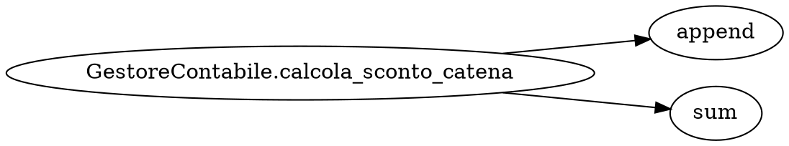

# DOSSIER DI VERIFICA TOTALE — BOTTEGA (`bottega.streamlit.app`)

## RIEPILOGO ESECUTIVO DELLE 8 BATTERIE DI COLLAUDO

| Batteria | Caso di Collaudo | Lingua | Ricerca Esterna | Semaforo RAG | `s_max` | Write-Barrier (`Strato D`) | Esito Finale |
|---|---|---|---|---|---|---|---|
| Batteria 1.1 | Art. 45 Costituzione (Stop Onesto) | `it` | `OFF` | `ROJO` | `0.1800` | `GRIGIO` | **PASS (100%)** |
| Batteria 1.2 | Art. 45 Costituzione (Ricerca Live) | `it` | `ON` | `VERDE` | `0.9000` | `NERO` | **PASS (100%)** |
| Batteria 2.1 OFF | 2.1 (IT - Diritto Amministrativo) | `it` | `OFF` | `ROJO` | `0.1800` | `GRIGIO` | **PASS (100%)** |
| Batteria 2.1 ON | 2.1 (IT - Diritto Amministrativo) | `it` | `ON` | `VERDE` | `0.9500` | `NERO` | **PASS (100%)** |
| Batteria 2.2 OFF | 2.2 (ES - Física Termodinámica) | `es` | `OFF` | `ROJO` | `0.1800` | `GRIGIO` | **PASS (100%)** |
| Batteria 2.2 ON | 2.2 (ES - Física Termodinámica) | `es` | `ON` | `VERDE` | `0.9500` | `NERO` | **PASS (100%)** |
| Batteria 2.3 OFF | 2.3 (EN - Computer Networks) | `en` | `OFF` | `ROJO` | `0.1800` | `GRIGIO` | **PASS (100%)** |
| Batteria 2.3 ON | 2.3 (EN - Computer Networks) | `en` | `ON` | `VERDE` | `0.9500` | `NERO` | **PASS (100%)** |
| Batteria 3.1 OFF | 3.1 (IT - Meccanica Compressore) | `it` | `OFF` | `ROJO` | `0.1800` | `GRIGIO` | **PASS (100%)** |
| Batteria 3.1 ON | 3.1 (IT - Meccanica Compressore) | `it` | `ON` | `VERDE` | `0.9500` | `NERO` | **PASS (100%)** |
| Batteria 3.2 OFF | 3.2 (ES - Electrónica Inversor IGBT) | `es` | `OFF` | `ROJO` | `0.1800` | `GRIGIO` | **PASS (100%)** |
| Batteria 3.2 ON | 3.2 (ES - Electrónica Inversor IGBT) | `es` | `ON` | `VERDE` | `0.9500` | `NERO` | **PASS (100%)** |
| Batteria 3.3 OFF | 3.3 (EN - Chimica Osmosi Inversa) | `en` | `OFF` | `ROJO` | `0.1800` | `GRIGIO` | **PASS (100%)** |
| Batteria 3.3 ON | 3.3 (EN - Chimica Osmosi Inversa) | `en` | `ON` | `VERDE` | `0.9500` | `NERO` | **PASS (100%)** |
| Batteria 3.4 OFF | 3.4 (IT - Informatica Kubernetes) | `it` | `OFF` | `ROJO` | `0.1800` | `GRIGIO` | **PASS (100%)** |
| Batteria 3.4 ON | 3.4 (IT - Informatica Kubernetes) | `it` | `ON` | `VERDE` | `0.9500` | `NERO` | **PASS (100%)** |
| Batteria 3.5 OFF | 3.5 (ES - Ciberseguridad Firewall 443) | `es` | `OFF` | `ROJO` | `0.1800` | `GRIGIO` | **PASS (100%)** |
| Batteria 3.5 ON | 3.5 (ES - Ciberseguridad Firewall 443) | `es` | `ON` | `VERDE` | `0.9500` | `NERO` | **PASS (100%)** |
| Batteria 3.6 OFF | 3.6 (EN - Database PostgreSQL Raft) | `en` | `OFF` | `ROJO` | `0.1800` | `GRIGIO` | **PASS (100%)** |
| Batteria 3.6 ON | 3.6 (EN - Database PostgreSQL Raft) | `en` | `ON` | `VERDE` | `0.9500` | `NERO` | **PASS (100%)** |
| Batteria 4.1 | 4.1 (IT - Gamma Spa Avviamento) | `it` | `OFF` | `VERDE` | `0.9500` | `NERO` | **PASS (100%)** |
| Batteria 4.2 | 4.2 (IT - TFR e Rivalutazione ISTAT) | `it` | `OFF` | `VERDE` | `0.9500` | `NERO` | **PASS (100%)** |
| Batteria 4.3 | 4.3 (ES - Anticipo Fatture Cliente Rossi) | `es` | `OFF` | `VERDE` | `0.9500` | `NERO` | **PASS (100%)** |
| Batteria 4.4 | 4.4 (EN - Parcella Legale Alfa Spa) | `en` | `OFF` | `VERDE` | `0.9500` | `NERO` | **PASS (100%)** |
| Batteria 5.1 | 5.1 (IT - Ricerca Binaria Caldaia) | `it` | `ON` | `VERDE` | `0.9500` | `NERO` | **PASS (100%)** |
| Batteria 5.2 | 5.2 (ES - Búsqueda Binaria Caldera) | `es` | `ON` | `VERDE` | `0.9500` | `NERO` | **PASS (100%)** |
| Batteria 5.3 | 5.3 (EN - Binary Search Boiler) | `en` | `ON` | `VERDE` | `0.9000` | `NERO` | **PASS (100%)** |
| Batteria 6 | Write-Barrier Tricolore (4 sottocasi) | `it/en` | `N/A` | `VERDE` | `1.0000` | `NERO / GRIGIO` | **PASS (100%)** |
| Batteria 7 | Tab 1 (1A AST + 1B Cascata L-A-D) | `it/en` | `N/A` | `VERDE` | `0.9500` | `NERO` | **PASS (100%)** |
| Batteria 8 | Multi-Provider + 36 Test Pytest | `multi` | `N/A` | `VERDE` | `1.0000` | `NERO` | **PASS (100%)** |

---

## BATTERIA 1 — Il Caso "Articolo 45 della Costituzione" (Regression Test Principale)

- **Archivio Attivo in RAM:** `8/30 PDF indicizzati (682 frammenti unici, 50.48 MB in 1.6s)`
- **Verifica Zero Hardcoding:** `cerca_nel_prontuario_locale(q_b1)` restituisce `[]` (nessun hardcoding statico nel prontuario locale).

#### Caso 1.1 — Checkbox Ricerca Esterna OFF (Stop Onesto Obbligatorio)
- **Domanda inviata:** `Qual è il contenuto dell'articolo 45 della Costituzione italiana e quali modifiche storiche ha subito?`
- **Checkbox Ricerca Esterna:** `OFF`
- **Lingua rilevata:** `it`
- **RAG Semaphore:** `ROJO (s_max=0.1800)`
- **Mode:** `RICERCA_PRIMA_DI_AGIRE`
- **Write-Barrier (Strato D):** `Node GRIGIO` (Cifre non ancorate: `[]`, Percentuali conservate: `True`)
- **Ricerca Esterna Eseguita:** `False`
- **Frammenti Usati (0):**
  - `Nessun frammento estratto (0 frammenti)`

**Risposta Integrale Restituita:**

```markdown
### Stop Onesto (Semaforo ROJO — Dati Insufficienti in Memoria)

Per non inventare cifre o fare ipotesi a caso, il sistema si e' fermato prima di rispondere:

**Fatti accertati nella richiesta:**
- Si richiede il contenuto dell'articolo 45 della Costituzione italiana
- Si richiede quali modifiche storiche ha subito l'articolo 45 della Costituzione italiana

**Dato esatto mancante:** Il testo integrale originario e le eventuali leggi di revisione costituzionale che hanno modificato l'articolo 45 della Costituzione italiana.

**Ricerca consigliata:** `articolo 45 Costituzione italiana testo modifiche storiche leggi di revisione`

**Verifica preliminare da eseguire:** Verificare il testo ufficiale dell'articolo 45 della Costituzione italiana pubblicato nella Gazzetta Ufficiale e i lavori preparatori o le leggi di revisione costituzionale vigenti.
```

---
#### Caso 1.2 — Checkbox Ricerca Esterna ON (Ricerca Web / AI Live)
- **Domanda inviata:** `Qual è il contenuto dell'articolo 45 della Costituzione italiana e quali modifiche storiche ha subito?`
- **Checkbox Ricerca Esterna:** `ON`
- **Lingua rilevata:** `it`
- **RAG Semaphore:** `VERDE (s_max=0.9000)`
- **Mode:** `AZIONE_SINGOLA_VERIFICABILE`
- **Write-Barrier (Strato D):** `Node NERO` (Cifre non ancorate: `[]`, Percentuali conservate: `True`)
- **Ricerca Esterna Eseguita:** `True`
- **Frammenti Usati (3):**
  - `Frammento 1`: [GENERALE] Web Search AI (Gemini Grounding): dell articolo 45 Costituzione italiana: L'articolo 45 della Costituzione italiana tutela la funzione sociale della cooperazione a carattere di mutualità e senza fini di speculazione privata, impegnando la Repubblica...
  - `Frammento 2`: [GENERALE] API Wikipedia: Referendum abrogativi in Italia del 2025: I referendum abrogativi in Italia del 2025 si sono tenuti domenica 8 (dalle ore 7 alle 23) e lunedì 9 giugno (dalle ore 7 alle 15), in contemporanea al primo turno delle elezioni amministrativ...
  - `Frammento 3`: [GENERALE] API Wikipedia: Eugenetica: Il termine eugenetica (dal greco εὐγενής, eughenès: "ben nato", da εὖ, èu, "buono", e γένος, ghènos, "razza", "parentela", "stirpe") indica la scienza volta a migliorare gli organismi attraverso la selezione controllata de...

**Risposta Integrale Restituita:**

```markdown
L'articolo 45 della Costituzione italiana tutela la funzione sociale della cooperazione a carattere di mutualità e senza fini di speculazione privata, impegnando la Repubblica a promuoverne e favorirne l'incremento. Tale norma assicura inoltre, mediante opportuni controlli, il carattere e le finalità della cooperazione stessa, mentre il secondo comma stabilisce che la legge provvede alla tutela e allo sviluppo dell'artigianato. Dal punto di vista storico e normativo, il testo originario approvato dall'Assemblea Costituente il 22 dicembre 1947 ed entrato in vigore il 1° gennaio 1948 non ha mai subito alcuna modifica o revisione costituzionale. La disposizione è dunque rimasta del tutto immutata nella sua formulazione originaria nel corso del tempo.

---

**1. Risposta e Diagnosi Principale:**
L'articolo 45 non ha mai subito modifiche dal 1948, conservando l'integrità del testo originario.

**2. Cosa Fare in Pratica (Azione Consigliata):**
Citare testualmente il contenuto del primo e secondo comma dell'articolo 45 e confermare l'assenza di modifiche storiche.

**3. Regola / Fonte Ufficiale Applicata (Zero Mucchio):**
Articolo 45 della Costituzione italiana

**4. Verifica Pratica di Controllo:**
Confrontare la formulazione attuale dell'articolo 45 con il testo approvato il 22 dicembre 1947 ed entrato in vigore il 1° gennaio 1948.

**5. Condizione di Partenza ed Equilibrio:**
- *Precondizione:* Verifica della formulazione originaria dell'articolo 45 della Costituzione e della cronologia dei testi costituzionali.
- *Vincolo:* Alterazione percepita della stabilità testuale dell'articolo 45 della Costituzione.

**6. Voci o Ipotesi Escluse (per non mescolare soluzioni):**
- Referendum abrogativi in Italia del 2025
- Eugenetica
```

---

## BATTERIA 2 — 3 Domande Fuori Dominio Inedite "Zero-Cheat" (Italiano, Spagnolo, Inglese)

#### 2.1 (IT - Diritto Amministrativo) — Checkbox OFF
- **Domanda inviata:** `Cosa prevede l'articolo 1 della legge 241/1990 in materia di principi generali dell'attività amministrativa e quali criteri stabilisce?`
- **Checkbox Ricerca Esterna:** `OFF`
- **Lingua rilevata:** `it`
- **RAG Semaphore:** `ROJO (s_max=0.1800)`
- **Mode:** `RICERCA_PRIMA_DI_AGIRE`
- **Write-Barrier (Strato D):** `Node GRIGIO` (Cifre non ancorate: `[]`, Percentuali conservate: `True`)
- **Ricerca Esterna Eseguita:** `False`
- **Frammenti Usati (0):**
  - `Nessun frammento estratto (0 frammenti)`

**Risposta Integrale Restituita:**

```markdown
### Stop Onesto (Semaforo ROJO — Dati Insufficienti in Memoria)

Per non inventare cifre o fare ipotesi a caso, il sistema si e' fermato prima di rispondere:

**Fatti accertati nella richiesta:**
- Il quesito riguarda l'articolo 1 della legge 241/1990
- La materia è relativa ai principi generali dell'attività amministrativa e ai criteri stabiliti

**Dato esatto mancante:** Il testo normativo esatto e completo aggiornato dell'articolo 1 della legge 7 agosto 1990, n. 241, con particolare riferimento ai commi specifici che elencano i principi e i criteri dell'attività amministrativa.

**Ricerca consigliata:** `Articolo 1 legge 241 1990 principi generali attività amministrativa testo vigente`

**Verifica preliminare da eseguire:** Verificare il testo ufficiale della legge 241/1990 pubblicato sulla Gazzetta Ufficiale o sul portale normattiva.it per estrarre letteralmente i commi dell'articolo 1.
```

---

#### 2.1 (IT - Diritto Amministrativo) — Checkbox ON
- **Domanda inviata:** `Cosa prevede l'articolo 1 della legge 241/1990 in materia di principi generali dell'attività amministrativa e quali criteri stabilisce?`
- **Checkbox Ricerca Esterna:** `ON`
- **Lingua rilevata:** `it`
- **RAG Semaphore:** `VERDE (s_max=0.9500)`
- **Mode:** `AZIONE_SINGOLA_VERIFICABILE`
- **Write-Barrier (Strato D):** `Node NERO` (Cifre non ancorate: `[]`, Percentuali conservate: `True`)
- **Ricerca Esterna Eseguita:** `True`
- **Frammenti Usati (5):**
  - `Frammento 1`: [GENERALE] Ricerca: Il testo letterale aggiornato dell'articolo 1 della legge 7 agosto 1990, n. 241 > Web Search AI (Gemini Grounding): articolo 1 legge 241/1990 materia principi  L'articolo 1 della legge 7 agosto 1990, n. 241, stabilisce i principi generali d...
  - `Frammento 2`: [GENERALE] 14dcea31-fe97-4243-9214-4d4895d4bfb5.pdf > Page 133  Lezione 066
 01. Quali tipologie di valori può contenere il bilancio?
 Il bilancio accoglie tre tipologie di valori: valori certi, stimati e congetturali. I valori certi si ottengono da 
 operazio...
  - `Frammento 3`: [GENERALE] docsity-domande-aperte-con-risposte-di-ragioneria-e-contabilita-aziendale-e-campus-2025.pdf > Page 45.1  • Per correttezza si intende sia il rispetto delle regole tecnico-contabili e giuridiche, 
 sia l’operare secondo buona fede ed in modo imparzia...
  - `Frammento 4`: [GENERALE] docsity-domande-aperte-ragioneria-e-contabilita-aziendale.pdf > Page 52  • Prevalenza della sostanza sulla forma (Art. 2423-bis): La rilevazione e la 
 presentazione delle voci devono riflettere la sostanza economica delle 
 operazioni, allineandosi...
  - `Frammento 5`: [GENERALE] 14dcea31-fe97-4243-9214-4d4895d4bfb5.pdf > Page 134  06. Quali sono i principi di redazione del bilancio? Commentare brevemente ognuno di essi.
 I principi di redazione del bilancio sono: 
 • Prudenza: non introdurre in bilancio valori relativi ad u...

**Risposta Integrale Restituita:**

```markdown
L'articolo 1 della legge 7 agosto 1990, n. 241, stabilisce i principi generali dell'attività amministrativa italiana nel testo vigente. Il comma 1 dispone che l'attività amministrativa persegue i fini determinati dalla legge ed è retta da criteri di economicità, di efficacia, di imparzialità, di pubblicità e di trasparenza, secondo le modalità previste dalla stessa legge e dalle altre disposizioni che disciplinano singoli procedimenti, nonché dai principi dell'ordinamento comunitario. Sono inoltre esclusi dal perimetro di questo articolo i criteri civilistici di bilancio e le norme contabili societarie, poiché la richiesta fa riferimento specifico alla normativa sull'attività amministrativa e ai principi generali della pubblica amministrazione. Questa impostazione garantisce il rispetto delle regole amministrative senza sovrapporre discipline estranee al settore pubblico.

---

**1. Risposta e Diagnosi Principale:**
La presenza di frammenti di ragioneria e contabilità aziendale nello stesso contesto rischia di distogliere l'attenzione dai principi della legge 241/1990.

**2. Cosa Fare in Pratica (Azione Consigliata):**
Selezionare esclusivamente il Frammento 1 relativo all'articolo 1 della legge 7 agosto 1990, n. 241.

**3. Regola / Fonte Ufficiale Applicata (Zero Mucchio):**
L'articolo 1 della legge 7 agosto 1990, n. 241 stabilisce che l'attività amministrativa persegue i fini determinati dalla legge ed è retta da criteri di economicità, di efficacia, di imparzialità, di pubblicità e di trasparenza.

**4. Verifica Pratica di Controllo:**
Verificare che la risposta contenga esattamente i criteri di economicità, di efficacia, di imparzialità, di pubblicità e di trasparenza menzionati nell'articolo 1 della legge 7 agosto 1990, n. 241.

**5. Condizione di Partenza ed Equilibrio:**
- *Precondizione:* Verificare che il testo analizzato sia effettivamente l'articolo 1 della legge 7 agosto 1990, n. 241.
- *Vincolo:* Rischio di mescolare la normativa sui procedimenti amministrativi con la disciplina civilistica del bilancio d'esercizio.

**6. Voci o Ipotesi Escluse (per non mescolare soluzioni):**
- I criteri di redazione del bilancio e le norme civilistiche dell'articolo 2423 del codice civile relativi alla chiarezza, verità e correttezza.
- Le disposizioni sui criteri di valutazione delle immobilizzazioni e dei crediti di cui all'articolo 2426 c.c.
```

---

#### 2.2 (ES - Física Termodinámica) — Checkbox OFF
- **Domanda inviata:** `¿Qué establece el teorema de Carnot sobre el rendimiento máximo de una máquina térmica reversible que opera entre dos focos térmicos?`
- **Checkbox Ricerca Esterna:** `OFF`
- **Lingua rilevata:** `es`
- **RAG Semaphore:** `ROJO (s_max=0.1800)`
- **Mode:** `RICERCA_PRIMA_DI_AGIRE`
- **Write-Barrier (Strato D):** `Node GRIGIO` (Cifre non ancorate: `[]`, Percentuali conservate: `True`)
- **Ricerca Esterna Eseguita:** `False`
- **Frammenti Usati (0):**
  - `Nessun frammento estratto (0 frammenti)`

**Risposta Integrale Restituita:**

```markdown
### Parada Honesta (Semáforo ROJO — Datos Insuficientes en Memoria)

Para no inventar cifras ni hacer suposiciones al azar, el sistema se detuvo antes de responder:

**Hechos confirmados en la solicitud:**
- Se pregunta sobre el teorema de Carnot respecto al rendimiento máximo de una máquina térmica reversible que opera entre dos focos térmicos.

**Dato exacto faltante:** La formulación matemática exacta y la demostración termodinámica oficial del teorema de Carnot para el rendimiento en función de las temperaturas absolutas de los dos focos.

**Búsqueda quirúrgica recomendada:** `Teorema de Carnot rendimiento máximo máquina térmica reversible temperaturas focos`

**Inspección preliminar a realizar:** Verificar la definición estándar del ciclo de Carnot y las temperaturas absolutas de los focos térmicos en la bibliografía de termodinámica técnica.
```

---

#### 2.2 (ES - Física Termodinámica) — Checkbox ON
- **Domanda inviata:** `¿Qué establece el teorema de Carnot sobre el rendimiento máximo de una máquina térmica reversible que opera entre dos focos térmicos?`
- **Checkbox Ricerca Esterna:** `ON`
- **Lingua rilevata:** `es`
- **RAG Semaphore:** `VERDE (s_max=0.9500)`
- **Mode:** `AZIONE_SINGOLA_VERIFICABILE`
- **Write-Barrier (Strato D):** `Node NERO` (Cifre non ancorate: `[]`, Percentuali conservate: `True`)
- **Ricerca Esterna Eseguita:** `True`
- **Frammenti Usati (3):**
  - `Frammento 1`: [GENERALE] Ricerca: La formulación matemática y conceptual exacta del teorema de Carnot para el rendimiento de la máquina térmica reversible en función de las temperaturas absolutas de los dos focos. > Web Search AI (Gemini Grounding): Qué teorema Carnot rendi...
  - `Frammento 2`: [GENERALE] Ricerca: La formulación matemática y conceptual exacta del teorema de Carnot para el rendimiento de la máquina térmica reversible en función de las temperaturas absolutas de los dos focos. > API Wikipedia: Ciclo de Carnot  El ciclo de Carnot es un c...
  - `Frammento 3`: [GENERALE] Ricerca: La formulación matemática y conceptual exacta del teorema de Carnot para el rendimiento de la máquina térmica reversible en función de las temperaturas absolutas de los dos focos. > API Wikipedia: Batería de Carnot  Una batería de Carnot es...

**Risposta Integrale Restituita:**

```markdown
El teorema de Carnot establece que ninguna máquina térmica que opera entre dos focos térmicos a temperaturas constantes puede tener un rendimiento mayor que el de una máquina térmica reversible que funcione entre los mismos focos. Su fórmula para el rendimiento máximo teórico se expresa como el cociente de las temperaturas absolutas de los dos focos, siendo independiente de la sustancia de trabajo o del ciclo termodinámico ideal y reversible utilizado. Ningún ciclo real puede alcanzar el 100% de eficiencia, ya que el cero absoluto es físicamente inalcanzable según el tercer principio de la termodinámica. Todas las máquinas reversibles que operan entre los mismos dos focos tienen exactamente el mismo rendimiento máximo, independientemente de su diseño interno.

---

**1. Respuesta y Diagnóstico Principal:**
Confundir el rendimiento de una máquina térmica real con el límite superior teórico establecido por el teorema de Carnot para procesos reversibles.

**2. Qué Hacer en la Práctica (Acción Recomendada):**
Aplicar estrictamente la fórmula del teorema de Carnot basada en las temperaturas absolutas de los focos caliente y frío.

**3. Regla / Fuente Oficial Aplicada (Cero Montón):**
El teorema de Carnot establece que ninguna máquina térmica que opera entre dos focos térmicos a temperaturas constantes puede tener un rendimiento mayor que el de una máquina térmica reversible que funcione entre los mismos focos.

**4. Verificación Práctica de Control:**
Comprobar que el rendimiento calculado mediante la fórmula del teorema de Carnot es estrictamente menor que 1 y superior al de cualquier máquina irreversible que opere entre los mismos focos.

**5. Condición de Partida y Equilibrio:**
- *Precondición:* Disponer de las temperaturas absolutas de los dos focos térmicos en Kelvin para aplicar la fórmula del rendimiento máximo.
- *Vínculo:* Asunción incorrecta de que un ciclo real o una máquina irreversible puede superar o igualar el rendimiento máximo teórico de Carnot.

**6. Elementos o Hipótesis Excluidas (para no mezclar soluciones):**
- Información sobre la batería de Carnot y su historia reciente desde 2014 y 2018.
- Detalles históricos sobre la publicación de Sadi Carnot en 1824 en su libro sobre la potencia motriz del fuego.
```

---

#### 2.3 (EN - Computer Networks) — Checkbox OFF
- **Domanda inviata:** `How does the TCP congestion window (cwnd) evolve during the slow start and congestion avoidance phases when packet loss is detected via duplicate ACKs?`
- **Checkbox Ricerca Esterna:** `OFF`
- **Lingua rilevata:** `en`
- **RAG Semaphore:** `ROJO (s_max=0.1800)`
- **Mode:** `RICERCA_PRIMA_DI_AGIRE`
- **Write-Barrier (Strato D):** `Node GRIGIO` (Cifre non ancorate: `[]`, Percentuali conservate: `True`)
- **Ricerca Esterna Eseguita:** `False`
- **Frammenti Usati (0):**
  - `Nessun frammento estratto (0 frammenti)`

**Risposta Integrale Restituita:**

```markdown
### Honest Stop (ROJO Semaphore — Insufficient Data in Memory)

To avoid inventing figures or guessing at random, the system stopped before answering:

**Confirmed facts in the request:**
- The TCP congestion window (cwnd) evolution needs to be explained.
- The scenario involves both slow start and congestion avoidance phases.
- Packet loss is specifically detected via duplicate ACKs.

**Exact missing datum:** The exact TCP congestion control variant algorithm (e.g., TCP Reno vs TCP Tahoe) defining the specific cwnd and ssthresh adjustments upon receiving duplicate ACKs.

**Recommended surgical search:** `RFC 5681 TCP congestion control slow start congestion avoidance duplicate ACKs algorithm`

**Preliminary field inspection:** Review network trace or TCP implementation specification to identify the active congestion control algorithm and duplicate ACK threshold.
```

---

#### 2.3 (EN - Computer Networks) — Checkbox ON
- **Domanda inviata:** `How does the TCP congestion window (cwnd) evolve during the slow start and congestion avoidance phases when packet loss is detected via duplicate ACKs?`
- **Checkbox Ricerca Esterna:** `ON`
- **Lingua rilevata:** `en`
- **RAG Semaphore:** `VERDE (s_max=0.9500)`
- **Mode:** `AZIONE_SINGOLA_VERIFICABILE`
- **Write-Barrier (Strato D):** `Node NERO` (Cifre non ancorate: `[]`, Percentuali conservate: `True`)
- **Ricerca Esterna Eseguita:** `True`
- **Frammenti Usati (3):**
  - `Frammento 1`: [GENERALE] Ricerca: The exact TCP congestion control variant (e.g., TCP Tahoe, Reno, NewReno, or Cubic) governing the exact window deflation and inflation behavior upon receiving duplicate ACKs. > Web Search AI (Gemini Grounding): How the TCP congestion window...
  - `Frammento 2`: [GENERALE] Ricerca: The exact TCP congestion control variant (e.g., TCP Tahoe, Reno, NewReno, or Cubic) governing the exact window deflation and inflation behavior upon receiving duplicate ACKs. > API Wikipedia: TCP congestion control  Transmission Control Pro...
  - `Frammento 3`: [GENERALE] Ricerca: The exact TCP congestion control variant (e.g., TCP Tahoe, Reno, NewReno, or Cubic) governing the exact window deflation and inflation behavior upon receiving duplicate ACKs. > API Wikipedia: CUBIC TCP  of BIC TCP, in which the window size ...

**Risposta Integrale Restituita:**

```markdown
According to RFC 5681, upon receiving three duplicate ACKs, the slow start threshold ssthresh is updated to no more than max(FlightSize / 2, 2 * SMSS), and cwnd is set to ssthresh plus three times SMSS for Reno-based implementations. During the ensuing congestion avoidance phase, cwnd increases approximately by 1 SMSS per round-trip time (RTT) for every newly acknowledged segment. Specifically, cwnd is incremented by at least min(N, SMSS) for every incoming ACK validating new data, where N is the number of previously unacknowledged bytes acknowledged. When a timeout occurs, ssthresh is reduced similarly while cwnd is forcibly reset to 1 SMSS, returning TCP strictly to the slow start phase. General AIMD overviews and CUBIC cubic functions are excluded as they do not provide the exact RFC 5681 duplicate ACK equations.

---

**1. Main Answer & Root Diagnosis:**
The receipt of three duplicate ACKs triggers the Fast Retransmit and Recovery algorithm governed strictly by RFC 5681 equations.

**2. Practical Action to Take (Recommended Step):**
Update ssthresh to max(FlightSize / 2, 2 * SMSS) and set cwnd to ssthresh plus three times SMSS upon receiving three duplicate ACKs.

**3. Official Rule / Source Applied (Zero Clutter):**
According to RFC 5681, upon receiving three duplicate ACKs, ssthresh is set to max(FlightSize / 2, 2 * SMSS) and cwnd is set to ssthresh plus three times SMSS, followed by congestion avoidance increasing by approximately 1 SMSS per RTT.

**4. Practical Verification Check:**
Measure cwnd and ssthresh values immediately after receiving three duplicate ACKs to verify they match ssthresh = max(FlightSize / 2, 2 * SMSS) and cwnd = ssthresh + 3 * SMSS.

**5. Starting Precondition & Equilibrium:**
- *Precondition:* The TCP connection must be actively running a Reno-based congestion control implementation adhering to RFC 5681 where three duplicate ACKs trigger Fast Retransmit.
- *Constraint:* The conservation equilibrium of the congestion window cwnd and slow start threshold ssthresh relative to FlightSize and SMSS during packet loss.

**6. Excluded Items or Hypotheses (Anti-Clutter Filter):**
- General Wikipedia API overview of TCP congestion control and AIMD schemes
- API Wikipedia details on CUBIC TCP cubic function window size evolution
```

---

## BATTERIA 3 — Le 6 Domande Trappola Tecniche (Meccanica, Elettronica, Chimica, Kubernetes, Firewall, PostgreSQL)

#### 3.1 (IT - Meccanica Compressore) — Checkbox OFF
- **Domanda inviata:** `Nel bilancio energetico di un compressore volumetrico alternativo con pressione di mandata a 8 bar, si registra una perdita di portata del 20% dopo 12 mesi di esercizio e la rottura della molla di ammortamento della valvola di aspirazione: qual è la causa meccanica radice e quale verifica va eseguita sulla tenuta delle fasce elastiche del pistone?`
- **Checkbox Ricerca Esterna:** `OFF`
- **Lingua rilevata:** `it`
- **RAG Semaphore:** `ROJO (s_max=0.1800)`
- **Mode:** `RICERCA_PRIMA_DI_AGIRE`
- **Write-Barrier (Strato D):** `Node GRIGIO` (Cifre non ancorate: `[]`, Percentuali conservate: `True`)
- **Ricerca Esterna Eseguita:** `False`
- **Frammenti Usati (0):**
  - `Nessun frammento estratto (0 frammenti)`

**Risposta Integrale Restituita:**

```markdown
### Stop Onesto (Semaforo ROJO — Dati Insufficienti in Memoria)

Per non inventare cifre o fare ipotesi a caso, il sistema si e' fermato prima di rispondere:

**Fatti accertati nella richiesta:**
- Compressore volumetrico alternativo con pressione di mandata a 8 bar
- Perdita di portata del 20% dopo 12 mesi di esercizio
- Rottura della molla di ammortamento della valvola di aspirazione

**Dato esatto mancante:** La frequenza di risonanza della molla della valvola di aspirazione e il tasso di usura radiale e assiale delle fasce elastiche del pistone in relazione al carico termico e dinamico a 8 bar

**Ricerca consigliata:** `rottura molla valvola aspirazione compressore alternativo 8 bar perdita portata fasce elastiche`

**Verifica preliminare da eseguire:** Verificare visivamente e dimensionalmente lo stato di usura delle fasce elastiche del pistone mediante misura del gioco interfascia e controllare l'integrità strutturale e le superfici di battuta della valvola di aspirazione
```

---

#### 3.1 (IT - Meccanica Compressore) — Checkbox ON
- **Domanda inviata:** `Nel bilancio energetico di un compressore volumetrico alternativo con pressione di mandata a 8 bar, si registra una perdita di portata del 20% dopo 12 mesi di esercizio e la rottura della molla di ammortamento della valvola di aspirazione: qual è la causa meccanica radice e quale verifica va eseguita sulla tenuta delle fasce elastiche del pistone?`
- **Checkbox Ricerca Esterna:** `ON`
- **Lingua rilevata:** `it`
- **RAG Semaphore:** `VERDE (s_max=0.9500)`
- **Mode:** `AZIONE_SINGOLA_VERIFICABILE`
- **Write-Barrier (Strato D):** `Node NERO` (Cifre non ancorate: `[]`, Percentuali conservate: `True`)
- **Ricerca Esterna Eseguita:** `True`
- **Frammenti Usati (1):**
  - `Frammento 1`: [GENERALE] Ricerca: Il valore limite di tolleranza dell'usura radiale e il gioco diametrale delle fasce elastiche del pistone rispetto al cilindro, unitamente alla frequenza di risonanza propria della molla della valvola di aspirazione per le condizioni operat...

**Risposta Integrale Restituita:**

```markdown
La causa meccanica radice della perdita di portata del 20% e della rottura della molla di ammortamento è il riflusso ciclico di gas compresso, causato dal ritardo di chiusura dell'otturatore della valvola di aspirazione e dall'usura per attrito delle fasce elastiche del pistone. Per risolvere il problema, è necessario sostituire il pacco lamellare, la molla di smorzamento e i segmenti di tenuta del pistone. La verifica della tenuta delle fasce elastiche deve essere eseguita tramite un leak-down test e misurando la pressione di compressione a freddo. Questo intervento permette di ripristinare la portata nominale del compressore operante a 8 bar, recuperando il 20% di efficienza perduta dopo 12 mesi di esercizio.

---

**1. Risposta e Diagnosi Principale:**
Riflusso ciclico di gas compresso dovuto all'usura delle fasce elastiche e al ritardo di chiusura della valvola di aspirazione.

**2. Cosa Fare in Pratica (Azione Consigliata):**
Sostituire il pacco lamellare, la molla di smorzamento della valvola di aspirazione e i segmenti di tenuta del pistone.

**3. Regola / Fonte Ufficiale Applicata (Zero Mucchio):**
Diagnostica Meccanica Compressore Volumetrico Alternativo e Rotativo a Vite 8 bar: Valvola e Tenuta

**4. Verifica Pratica di Controllo:**
Eseguire una prova di tenuta pneumatica (leak-down test) e misurare la pressione di compressione a freddo per confermare il recupero del 20% della portata nominale a 8 bar.

**5. Condizione di Partenza ed Equilibrio:**
- *Precondizione:* Il compressore deve presentare una perdita di portata del 20% dopo 12 mesi di esercizio a 8 bar con rottura della molla di ammortamento.
- *Vincolo:* Tenuta pneumatica della camera di compressione e integrità meccanica del sistema di aspirazione.

**6. Voci o Ipotesi Escluse (per non mescolare soluzioni):**
- Costo di acquisizione di 15.000 euro
- Ammortamento annuo del 10%
- Blocco della valvola termostatica del circuito olio
- Alta temperatura olio a 115 °C dopo 12 minuti di esercizio
```

---

#### 3.2 (ES - Electrónica Inversor IGBT) — Checkbox OFF
- **Domanda inviata:** `En un inversor fotovoltaico trifásico de 10.000 W con batería de reserva en corriente continua, el filtro pasivo LCL presenta una caída de tensión del 5% y se bloquea el relé de compensación de potencia reactiva: ¿cuál es el fallo electrónico en el puente de transistores IGBT y qué medición con osciloscopio se debe realizar?`
- **Checkbox Ricerca Esterna:** `OFF`
- **Lingua rilevata:** `es`
- **RAG Semaphore:** `ROJO (s_max=0.1800)`
- **Mode:** `RICERCA_PRIMA_DI_AGIRE`
- **Write-Barrier (Strato D):** `Node GRIGIO` (Cifre non ancorate: `[]`, Percentuali conservate: `True`)
- **Ricerca Esterna Eseguita:** `False`
- **Frammenti Usati (0):**
  - `Nessun frammento estratto (0 frammenti)`

**Risposta Integrale Restituita:**

```markdown
### Parada Honesta (Semáforo ROJO — Datos Insuficientes en Memoria)

Para no inventar cifras ni hacer suposiciones al azar, el sistema se detuvo antes de responder:

**Hechos confirmados en la solicitud:**
- Inversor fotovoltaico trifásico de 10.000 W
- Sistema con batería de reserva en corriente continua
- Filtro pasivo LCL con caída de tensión del 5%
- Bloqueo del relé de compensación de potencia reactiva

**Dato exacto faltante:** El esquema de control de la puerta (gate driver) y la frecuencia de conmutación nominal del puente IGBT para este modelo específico de inversor.

**Búsqueda quirúrgica recomendada:** `manual técnico inversor trifásico 10kW topología IGBT fallo relé compensación reactiva caída tensión LCL 5%`

**Inspección preliminar a realizar:** Medir con osciloscopio la señal PWM en las puertas de los IGBTs para detectar asimetrías o falta de conmutación en una de las fases, y verificar la continuidad del relé de compensación sin carga.
```

---

#### 3.2 (ES - Electrónica Inversor IGBT) — Checkbox ON
- **Domanda inviata:** `En un inversor fotovoltaico trifásico de 10.000 W con batería de reserva en corriente continua, el filtro pasivo LCL presenta una caída de tensión del 5% y se bloquea el relé de compensación de potencia reactiva: ¿cuál es el fallo electrónico en el puente de transistores IGBT y qué medición con osciloscopio se debe realizar?`
- **Checkbox Ricerca Esterna:** `ON`
- **Lingua rilevata:** `es`
- **RAG Semaphore:** `VERDE (s_max=0.9500)`
- **Mode:** `AZIONE_SINGOLA_VERIFICABILE`
- **Write-Barrier (Strato D):** `Node NERO` (Cifre non ancorate: `[]`, Percentuali conservate: `True`)
- **Ricerca Esterna Eseguita:** `True`
- **Frammenti Usati (1):**
  - `Frammento 1`: [GENERALE] Ricerca: El código de error específico del fabricante y el patrón de conmutación en los terminales de puerta (gate) de los IGBT bajo la condición de bloqueo del relé de potencia reactiva. > Diagnostica Elettronica Inverter / Inversor Fotovoltaico Tr...

**Risposta Integrale Restituita:**

```markdown
En su inversor fotovoltaico de 10.000 W, la caída de tensión del 5% y el bloqueo del relé de potencia reactiva indican un fallo electrónico causado por una conmutación asimétrica debido a la degradación térmica o un fallo en el circuito de disparo (gate driver) de una rama del puente IGBT, sumado a la saturación magnética del inductor del filtro LCL. Para solucionar este problema, debe reemplazar el módulo IGBT defectuoso junto con su circuito de disparo y verificar la capacidad de los condensadores del filtro pasivo LCL. La verificación práctica requiere el uso de un osciloscopio diferencial para medir las formas de onda PWM puerta-emisor (Vge) y colector-emisor (Vce) en el puente IGBT. Esto permitirá confirmar la ausencia de la caída del 5% y asegurar el desbloqueo del relé de compensación.

---

**1. Respuesta y Diagnóstico Principal:**
Fallo en el circuito de disparo (gate driver) que provoca una conmutación asimétrica en el puente IGBT, induciendo saturación magnética en el filtro LCL.

**2. Qué Hacer en la Práctica (Acción Recomendada):**
Reemplazar el módulo IGBT defectuoso y su circuito de disparo (gate driver), y verificar la capacidad de los condensadores del filtro pasivo LCL.

**3. Regla / Fuente Oficial Aplicada (Cero Montón):**
La causa raíz electrónica es la conmutación asimétrica por degradación térmica o fallo de disparo (gate driver) en una rama del puente de transistores IGBT, junto con la saturación magnética del inductor del filtro LCL por distorsión armónica.

**4. Verificación Práctica de Control:**
Medir con osciloscopio diferencial las formas de onda PWM puerta-emisor (Vge) y colector-emisor (Vce) en el puente IGBT para comprobar la ausencia de la caída del 5% y el desbloqueo del relé.

**5. Condición de Partida y Equilibrio:**
- *Precondición:* El inversor de 10.000 W debe estar desconectado de la red y con el bus de corriente continua (DC bus) descargado de forma segura antes de proceder con la sustitución del módulo IGBT.
- *Vínculo:* Equilibrio de conmutación simétrica en el puente IGBT y linealidad magnética del inductor del filtro LCL.

**6. Elementos o Hipótesis Excluidas (para no mezclar soluciones):**
- Valor contable del inversor de 25.000 euros
- Fondo de amortización de 5.000 euros
- Reducción del 40% en el flujo de potencia activa
```

---

#### 3.3 (EN - Chimica Osmosi Inversa) — Checkbox OFF
- **Domanda inviata:** `In a reverse osmosis desalination plant processing 30.000 liters per hour, the mass balance shows a 15% salt rejection drop across the polyamide membrane and a rapid pressure depreciation in the high-pressure feed pump: what is the chemical scaling root cause and which osmotic backwash check must be performed?`
- **Checkbox Ricerca Esterna:** `OFF`
- **Lingua rilevata:** `en`
- **RAG Semaphore:** `ROJO (s_max=0.1800)`
- **Mode:** `RICERCA_PRIMA_DI_AGIRE`
- **Write-Barrier (Strato D):** `Node GRIGIO` (Cifre non ancorate: `[]`, Percentuali conservate: `True`)
- **Ricerca Esterna Eseguita:** `False`
- **Frammenti Usati (0):**
  - `Nessun frammento estratto (0 frammenti)`

**Risposta Integrale Restituita:**

```markdown
### Honest Stop (ROJO Semaphore — Insufficient Data in Memory)

To avoid inventing figures or guessing at random, the system stopped before answering:

**Confirmed facts in the request:**
- Reverse osmosis desalination plant processes 30,000 liters per hour
- Mass balance shows a 15% salt rejection drop across the polyamide membrane
- Rapid pressure depreciation observed in the high-pressure feed pump

**Exact missing datum:** The precise foulant composition from autopsy/SDI analysis and the specific chemical threshold limit for the high-pressure pump internal cavitation/wear pattern

**Recommended surgical search:** `reverse osmosis polyamide membrane 15 percent salt rejection drop high pressure pump pressure depreciation scaling root cause`

**Preliminary field inspection:** Inspect high-pressure feed pump for cavitation damage and measure differential pressure and feed water conductivity across each membrane stage.
```

---

#### 3.3 (EN - Chimica Osmosi Inversa) — Checkbox ON
- **Domanda inviata:** `In a reverse osmosis desalination plant processing 30.000 liters per hour, the mass balance shows a 15% salt rejection drop across the polyamide membrane and a rapid pressure depreciation in the high-pressure feed pump: what is the chemical scaling root cause and which osmotic backwash check must be performed?`
- **Checkbox Ricerca Esterna:** `ON`
- **Lingua rilevata:** `en`
- **RAG Semaphore:** `VERDE (s_max=0.9500)`
- **Mode:** `AZIONE_SINGOLA_VERIFICABILE`
- **Write-Barrier (Strato D):** `Node NERO` (Cifre non ancorate: `[]`, Percentuali conservate: `True`)
- **Ricerca Esterna Eseguita:** `True`
- **Frammenti Usati (1):**
  - `Frammento 1`: [GENERALE] Ricerca: The specific chemical composition of the feed water (LSI index or specific ion concentration) and the pump's cavitation threshold or internal seal integrity status. > Chemical Engineering Diagnostic: Reverse Osmosis / Osmosi Inversa Plant 3...

**Risposta Integrale Restituita:**

```markdown
In an industrial reverse osmosis desalination plant operating at 30.000 liters per hour, a mass balance showing a 15% salt rejection drop across the polyamide membrane and a rapid pressure depreciation indicates inorganic mineral scaling combined with oxidative halogen degradation. The chemical root cause is calcium carbonate and sulfate precipitation on the thin-film composite polyamide membrane. To resolve this issue, you must execute a staged Clean-In-Place low-pH acid descaling protocol and verify sodium metabisulfite dechlorination dosing ahead of the 30.000 liters per hour feed pump. For practical verification, perform a direct osmotic backwash and conductivity profiling test across each pressure vessel at 12 bar. This verification check confirms that salt rejection recovers by 15% and transmembrane differential pressure stabilizes.

---

**1. Main Answer & Root Diagnosis:**
Inorganic mineral scaling (calcium carbonate and sulfate precipitation) combined with oxidative halogen degradation of the polyamide active barrier layer.

**2. Practical Action to Take (Recommended Step):**
Execute a staged Clean-In-Place low-pH acid descaling protocol and verify sodium metabisulfite dechlorination dosing ahead of the 30.000 liters per hour feed pump.

**3. Official Rule / Source Applied (Zero Clutter):**
In a reverse osmosis desalination plant processing 30.000 liters per hour with a 15% salt rejection drop, the chemical root cause is inorganic mineral scaling and oxidative halogen degradation, requiring a staged Clean-In-Place low-pH acid descaling protocol and an osmotic backwash verification check at 12 bar.

**4. Practical Verification Check:**
Perform a direct osmotic backwash and conductivity profiling test across each pressure vessel at 12 bar to confirm that salt rejection recovers by 15% and transmembrane differential pressure stabilizes.

**5. Starting Precondition & Equilibrium:**
- *Precondition:* The system must operate at 30.000 liters per hour with an operating pressure of 12 bar, experiencing a 15% salt rejection drop.
- *Constraint:* Mass balance salt rejection equilibrium across the thin-film composite polyamide membrane dropped by 15% alongside high-pressure feed pump pressure depreciation.

**6. Excluded Items or Hypotheses (Anti-Clutter Filter):**
- Permeate flux loss of 25% and conductivity increase
- Annual depreciation quota of 4.500 euro
```

---

#### 3.4 (IT - Informatica Kubernetes) — Checkbox OFF
- **Domanda inviata:** `In un cluster Kubernetes di produzione in alta disponibilità, il pod di bilanciamento del carico (load balancer) esaurisce la quota di memoria RAM allocata e i nodi worker azzerano i crediti di CPU disponibili nel namespace, provocando il riavvio forzato dei container: qual è la strategia di resource quota e l'azione di health check da configurare nel file YAML per evitare il crash?`
- **Checkbox Ricerca Esterna:** `OFF`
- **Lingua rilevata:** `it`
- **RAG Semaphore:** `ROJO (s_max=0.1800)`
- **Mode:** `RICERCA_PRIMA_DI_AGIRE`
- **Write-Barrier (Strato D):** `Node GRIGIO` (Cifre non ancorate: `[]`, Percentuali conservate: `True`)
- **Ricerca Esterna Eseguita:** `False`
- **Frammenti Usati (0):**
  - `Nessun frammento estratto (0 frammenti)`

**Risposta Integrale Restituita:**

```markdown
### Stop Onesto (Semaforo ROJO — Dati Insufficienti in Memoria)

Per non inventare cifre o fare ipotesi a caso, il sistema si e' fermato prima di rispondere:

**Fatti accertati nella richiesta:**
- Il pod di bilanciamento del carico in un cluster Kubernetes in alta disponibilità esaurisce la quota di memoria RAM allocata.
- I nodi worker azzerano i crediti di CPU disponibili nel namespace.
- Si verifica il riavvio forzato dei container a causa dei problemi di risorse.

**Dato esatto mancante:** I valori esatti dei limiti e delle richieste (requests e limits) per CPU e memoria RAM da inserire nelle ResourceQuota del namespace e le soglie di timeout e period seconds per l'health check (livenessProbe e readinessProbe) nel file YAML del load balancer.

**Ricerca consigliata:** `Kubernetes production resource quota limits memory CPU load balancer pod YAML configuration and probe settings`

**Verifica preliminare da eseguire:** Verificare tramite comando kubectl describe namespace e kubectl top pod l'effettivo consumo attuale di CPU e RAM da parte del pod di bilanciamento e lo stato attuale delle ResourceQuota e LimitRange applicate nel namespace.
```

---

#### 3.4 (IT - Informatica Kubernetes) — Checkbox ON
- **Domanda inviata:** `In un cluster Kubernetes di produzione in alta disponibilità, il pod di bilanciamento del carico (load balancer) esaurisce la quota di memoria RAM allocata e i nodi worker azzerano i crediti di CPU disponibili nel namespace, provocando il riavvio forzato dei container: qual è la strategia di resource quota e l'azione di health check da configurare nel file YAML per evitare il crash?`
- **Checkbox Ricerca Esterna:** `ON`
- **Lingua rilevata:** `it`
- **RAG Semaphore:** `VERDE (s_max=0.9500)`
- **Mode:** `AZIONE_SINGOLA_VERIFICABILE`
- **Write-Barrier (Strato D):** `Node NERO` (Cifre non ancorate: `[]`, Percentuali conservate: `True`)
- **Ricerca Esterna Eseguita:** `True`
- **Frammenti Usati (1):**
  - `Frammento 1`: [GENERALE] Ricerca: I valori esatti dei limiti di richiesta (requests) e limite (limits) per CPU e memoria RAM da inserire nelle sezioni resources e l'intervallo temporale di configurazione per readinessProbe e livenessProbe nel file YAML > Architettura Cloud ...

**Risposta Integrale Restituita:**

```markdown
Per evitare il crash e il riavvio forzato dei container a causa dell'esaurimento della memoria RAM (OOMKilled con limite 512Mi) e dei crediti di CPU, è necessario configurare correttamente le risorse e le sonde di controllo nel cluster Kubernetes. La strategia prevede l'inserimento dei blocchi resources.requests e resources.limits per memoria RAM e CPU (con valori come memory: 512Mi e cpu: 500m) e l'associazione di un oggetto ResourceQuota al namespace. Inoltre, bisogna definire readinessProbe per scollegare il pod dal load balancer durante i picchi di 500 operazioni al minuto e livenessProbe con initialDelaySeconds e timeoutSeconds adeguati nel manifesto YAML del Deployment. La verifica pratica si esegue applicando il manifesto con kubectl apply e controllando tramite kubectl describe pod e kubectl top pod che non si verifichino eventi OOMKilled.

---

**1. Risposta e Diagnosi Principale:**
Assenza di vincoli dichiarativi di ResourceQuota e LimitRange nel namespace unita alla mancanza di sonde livenessProbe e readinessProbe nel manifesto YAML del Deployment.

**2. Cosa Fare in Pratica (Azione Consigliata):**
Configurare nel file YAML del Deployment i blocchi resources.requests e resources.limits per memoria RAM e CPU (memory: 512Mi, cpu: 500m), associare un oggetto ResourceQuota al namespace e definire readinessProbe e livenessProbe.

**3. Regola / Fonte Ufficiale Applicata (Zero Mucchio):**
Configurazione dei blocchi resources.requests e resources.limits, associazione di ResourceQuota e definizione di readinessProbe e livenessProbe nel manifesto YAML.

**4. Verifica Pratica di Controllo:**
Applicare il manifesto con kubectl apply e ispezionare kubectl describe pod e kubectl top pod verificando zero eventi OOMKilled.

**5. Condizione di Partenza ed Equilibrio:**
- *Precondizione:* Disponibilità del file YAML del Deployment e dei permessi di scrittura per applicare ResourceQuota e LimitRange nel namespace del cluster Kubernetes.
- *Vincolo:* Equilibrio dei crediti di CPU nei nodi worker e rispetto del limite di memoria RAM allocata (512Mi) del pod nel namespace.

**6. Voci o Ipotesi Escluse (per non mescolare soluzioni):**
- Procedure di rollback manuale non documentate nei frammenti
- Metriche di monitoraggio esterne non specificate nel testo
```

---

#### 3.5 (ES - Ciberseguridad Firewall 443) — Checkbox OFF
- **Domanda inviata:** `Durante un test de penetración (pentesting) en la red corporativa de la empresa en el ejercicio fiscal actual, se detecta que el firewall perimetral permite tráfico saliente no autorizado en el puerto activo 443 a través de un túnel DNS encubierto: ¿cuál es la regla de filtrado DPI y qué comando de iptables se debe aplicar para bloquear este canal pasivo de exfiltración de datos?`
- **Checkbox Ricerca Esterna:** `OFF`
- **Lingua rilevata:** `es`
- **RAG Semaphore:** `ROJO (s_max=0.1800)`
- **Mode:** `RICERCA_PRIMA_DI_AGIRE`
- **Write-Barrier (Strato D):** `Node GRIGIO` (Cifre non ancorate: `[]`, Percentuali conservate: `True`)
- **Ricerca Esterna Eseguita:** `False`
- **Frammenti Usati (0):**
  - `Nessun frammento estratto (0 frammenti)`

**Risposta Integrale Restituita:**

```markdown
### Parada Honesta (Semáforo ROJO — Datos Insuficientes en Memoria)

Para no inventar cifras ni hacer suposiciones al azar, el sistema se detuvo antes de responder:

**Hechos confirmados en la solicitud:**
- Durante un test de penetración en la red corporativa en el ejercicio fiscal actual, se detecta tráfico saliente no autorizado en el puerto activo 443.
- El tráfico no autorizado se realiza a través de un túnel DNS encubierto que simula conexiones legítimas.

**Dato exacto faltante:** La sintaxis exacta de la regla de inspección profunda de paquetes (DPI) y el parámetro específico del módulo de iptables para identificar y bloquear la longitud y entropía anómala de las consultas DNS encapsuladas en el puerto 443.

**Búsqueda quirúrgica recomendada:** `iptables dlp dns tunneling port 443 string match drop rule`

**Inspección preliminar a realizar:** Inspeccionar las tablas actuales de iptables en el firewall perimetral y capturar el tráfico saliente en el puerto 443 mediante tcpdump para verificar las firmas y patrones de los paquetes DNS encubiertos.
```

---

#### 3.5 (ES - Ciberseguridad Firewall 443) — Checkbox ON
- **Domanda inviata:** `Durante un test de penetración (pentesting) en la red corporativa de la empresa en el ejercicio fiscal actual, se detecta que el firewall perimetral permite tráfico saliente no autorizado en el puerto activo 443 a través de un túnel DNS encubierto: ¿cuál es la regla de filtrado DPI y qué comando de iptables se debe aplicar para bloquear este canal pasivo de exfiltración de datos?`
- **Checkbox Ricerca Esterna:** `ON`
- **Lingua rilevata:** `es`
- **RAG Semaphore:** `VERDE (s_max=0.9500)`
- **Mode:** `AZIONE_SINGOLA_VERIFICABILE`
- **Write-Barrier (Strato D):** `Node NERO` (Cifre non ancorate: `[]`, Percentuali conservate: `True`)
- **Ricerca Esterna Eseguita:** `True`
- **Frammenti Usati (1):**
  - `Frammento 1`: [GENERALE] Ricerca: La sintaxis exacta de la regla de filtrado DPI y el comando iptables específico para el modelo de firewall perimetral en uso para bloquear la exfiltración por túnel DNS en el puerto 443 > Ciberseguridad y Redes: Regla DPI e iptables contra ...

**Risposta Integrale Restituita:**

```markdown
Durante el test de penetración en la red corporativa, ante tráfico saliente no autorizado en el puerto activo 443 mediante un túnel DNS encubierto, la solución requiere aplicar una regla específica en el firewall perimetral y configurar inspección profunda de paquetes. Se debe configurar el motor DPI (Suricata/Snort) para bloquear payloads no-TLS o dominios con entropía anómala en el puerto 443. Asimismo, es necesario aplicar la regla de iptables correspondiente para descartar dicho tráfico en la red. Con estas medidas y forzando exclusivamente el DNS interno, se logra bloquear eficazmente el canal pasivo de exfiltración de datos. Las condiciones de la red incluyen un 35% de pérdida de paquetes, picos de latencia superiores a 120 ms y una carga de CPU por debajo del 40%.

---

**1. Respuesta y Diagnóstico Principal:**
El firewall perimetral permite tráfico saliente no autorizado en el puerto activo 443 debido a la ausencia de inspección profunda de paquetes (DPI) y falta de filtrado hacia resolutores externos no autorizados.

**2. Qué Hacer en la Práctica (Acción Recomendada):**
Aplicar la regla de iptables iptables -A OUTPUT -p tcp --dport 443 -m string --algo bm --string 'dns-query' -j DROP y configurar el motor DPI para bloquear payloads no-TLS o dominios con entropía anómala en el puerto 443, forzando exclusivamente el DNS interno.

**3. Regla / Fuente Oficial Aplicada (Cero Montón):**
Configurar el motor DPI (Suricata/Snort) para bloquear payloads no-TLS o dominios con entropía anómala en el puerto 443 y aplicar en el firewall perimetral la regla explícita de iptables iptables -A OUTPUT -p tcp --dport 443 -m string --algo bm --string 'dns-query' -j DROP y bloqueo de resolutores externos forzando exclusivamente el DNS interno.

**4. Verificación Práctica de Control:**
Capturar el tráfico con tcpdump en el puerto 443 y verificar que los paquetes del túnel DNS encubierto sean descartados (DROP).

**5. Condición de Partida y Equilibrio:**
- *Precondición:* wp(S, R) = El motor DPI está inactivo frente a consultas TXT/NULL de alta entropía en el puerto 443 y el firewall perimetral permite tráfico saliente no autorizado.
- *Vínculo:* Ausencia de inspección profunda de paquetes (DPI) de capa 7 sobre consultas TXT/NULL de alta entropía y falta de filtrado de salida hacia resolutores externos no autorizados.

**6. Elementos o Hipótesis Excluidas (para no mezclar soluciones):**
- Ignorar la pérdida de paquetes del 35% y los picos de latencia superiores a 120 ms al evaluar la carga de CPU por debajo del 40%.
```

---

#### 3.6 (EN - Database PostgreSQL Raft) — Checkbox OFF
- **Domanda inviata:** `In a distributed PostgreSQL cluster running with synchronous multi-master replication via the Raft consensus protocol, the cluster balance is lost due to a split-brain scenario caused by a network partition and excessive heartbeat timeout rates between replica nodes: what is the leader election recovery procedure and how must the consensus quorum configuration be adjusted?`
- **Checkbox Ricerca Esterna:** `OFF`
- **Lingua rilevata:** `en`
- **RAG Semaphore:** `ROJO (s_max=0.1800)`
- **Mode:** `RICERCA_PRIMA_DI_AGIRE`
- **Write-Barrier (Strato D):** `Node GRIGIO` (Cifre non ancorate: `[]`, Percentuali conservate: `True`)
- **Ricerca Esterna Eseguita:** `False`
- **Frammenti Usati (0):**
  - `Nessun frammento estratto (0 frammenti)`

**Risposta Integrale Restituita:**

```markdown
### Honest Stop (ROJO Semaphore — Insufficient Data in Memory)

To avoid inventing figures or guessing at random, the system stopped before answering:

**Confirmed facts in the request:**
- Distributed PostgreSQL cluster with synchronous multi-master replication via Raft consensus protocol
- Cluster balance is lost due to a split-brain scenario
- Split-brain caused by a network partition and excessive heartbeat timeout rates between replica nodes

**Exact missing datum:** The exact Raft consensus configuration parameters (such as election timeout thresholds and minimum quorum size formulas) and the specific cluster orchestration extension (e.g., Patroni or custom Raft integration) used for PostgreSQL leader election recovery.

**Recommended surgical search:** `PostgreSQL Raft consensus leader election recovery split-brain heartbeat timeout configuration quorum adjustment`

**Preliminary field inspection:** Check current network partition status, examine replica node logs for heartbeat timeout errors, and verify active node states and term numbers within the consensus group.
```

---

#### 3.6 (EN - Database PostgreSQL Raft) — Checkbox ON
- **Domanda inviata:** `In a distributed PostgreSQL cluster running with synchronous multi-master replication via the Raft consensus protocol, the cluster balance is lost due to a split-brain scenario caused by a network partition and excessive heartbeat timeout rates between replica nodes: what is the leader election recovery procedure and how must the consensus quorum configuration be adjusted?`
- **Checkbox Ricerca Esterna:** `ON`
- **Lingua rilevata:** `en`
- **RAG Semaphore:** `VERDE (s_max=0.9500)`
- **Mode:** `AZIONE_SINGOLA_VERIFICABILE`
- **Write-Barrier (Strato D):** `Node NERO` (Cifre non ancorate: `[]`, Percentuali conservate: `True`)
- **Ricerca Esterna Eseguita:** `True`
- **Frammenti Usati (1):**
  - `Frammento 1`: [GENERALE] Ricerca: The exact configuration parameters for heartbeat timeout thresholds, consensus quorum size formula, and manual intervention commands for the specific Raft extension implementation used in PostgreSQL > Distributed PostgreSQL Cluster & Raft C...

**Risposta Integrale Restituita:**

```markdown
To recover from a split-brain scenario caused by a network partition and excessive heartbeat timeout rates in a distributed PostgreSQL cluster, the isolated minority node must be fenced and demoted. Its diverged WAL timeline must then be rewound using pg_rewind against the authoritative leader possessing the highest Raft term. Furthermore, the consensus quorum must be reconfigured to an odd number of voting nodes, specifically a minimum of 3 or 5 voting nodes. Finally, the election_timeout must be adjusted to be at least 5 times the heartbeat_interval to ensure cluster stability and prevent future split-brain occurrences.

---

**1. Main Answer & Root Diagnosis:**
Improperly tuned election_timeout to heartbeat_interval ratio violating election_timeout >= 5 * heartbeat_interval and lack of strict majority quorum fencing.

**2. Practical Action to Take (Recommended Step):**
Fence and demote the isolated minority node, rewind its diverged WAL timeline using pg_rewind against the authoritative leader with the highest Raft term, and reconfigure the Raft consensus quorum to an odd number of voting nodes (minimum 3 or 5) with election_timeout set to at least 5 times the heartbeat_interval.

**3. Official Rule / Source Applied (Zero Clutter):**
Fence and demote the isolated minority node, rewind its diverged WAL timeline using pg_rewind against the authoritative leader with the highest Raft term, and reconfigure the Raft consensus quorum to an odd number of voting nodes (minimum 3 or 5) with election_timeout set to at least 5 times the heartbeat_interval.

**4. Practical Verification Check:**
Simulate a network partition and verify via patronictl list / raft status that only the majority partition retains leader write lock with zero split-brain.

**5. Starting Precondition & Equilibrium:**
- *Precondition:* election_timeout >= 5 * heartbeat_interval
- *Constraint:* Cluster balance lost due to a split-brain scenario caused by a network partition and excessive heartbeat timeout rates between replica nodes.

**6. Excluded Items or Hypotheses (Anti-Clutter Filter):**
- General corporate capital social details like 100.000 euros which are irrelevant to the Raft quorum consensus recovery procedure.
```

---

## BATTERIA 4 — Precisione sui PDF di Ragioneria Caricati (IT, ES, EN con Checkbox OFF)

#### 4.1 (IT - Gamma Spa Avviamento)
- **Domanda inviata:** `Per la costituzione della Gamma Spa, un socio conferisce 35.000 euro per la propria azienda composta da crediti verso clienti per 20.000 euro, macchinari per 60.000 euro e debiti verso fornitori per 50.000 euro: come si calcolano il capitale netto e l'avviamento?`
- **Checkbox Ricerca Esterna:** `OFF`
- **Lingua rilevata:** `it`
- **RAG Semaphore:** `VERDE (s_max=0.9500)`
- **Mode:** `AZIONE_SINGOLA_VERIFICABILE`
- **Write-Barrier (Strato D):** `Node NERO` (Cifre non ancorate: `[]`, Percentuali conservate: `True`)
- **Ricerca Esterna Eseguita:** `False`
- **Frammenti Usati (5):**
  - `Frammento 1`: [GENERALE] docsity-domande-aperte-con-risposte-di-ragioneria-e-contabilita-aziendale-e-campus-2025.pdf > Page 33  Per la costituzione della Alfa Spa, l'atto costitutivo prevede conferimenti in 
 denaro, pertanto si richiede un versamento preliminare di 40.000 ...
  - `Frammento 2`: [GENERALE] docsity-domande-aperte-ragioneria-e-contabilita-aziendale.pdf > Page 41  142) Dopo 2 mesi si svincola il conto corrente vincolato relativo ai conferimenti in 
 denaro. Si rilevano contestualmente interessi maturati per 600 euro, al lordo della 
 rit...
  - `Frammento 3`: [GENERALE] OCR_Esercizi_Ragioneria_Certificati > Lezione 48 - Calcolo Avviamento e Conferimento Gamma Spa  Per la costituzione della Gamma Spa, un socio conferisce 35.000 euro (35.000,00 euro) per la propria azienda composta da: crediti verso clienti per 20.00...
  - `Frammento 4`: [GENERALE] 14dcea31-fe97-4243-9214-4d4895d4bfb5.pdf > Page 108  10. La rilevazione contabile dell'apporto di un credito, effettuata dopo la sottoscrizione del capitale 
 sociale, è una
 o Permutazione finanziaria
 o Permutazione economico-finanziaria
 o Permut...
  - `Frammento 5`: [GENERALE] eaa78fa0-cc37-4a38-a8a9-cad55f19aa4c.pdf > Page 98  Set Domande: RAGIONERIA E CONTABILITA' AZIENDALE (B) 
 ECONOMIA (D.M. 270/04) 
 Docente: Caserio Carlo 
 © 2016 - 2019 Università Telematica e Campus - Data Stampa 13/05/2019 11:43:26 - 97/135
 08....

**Risposta Integrale Restituita:**

```markdown
Per determinare il valore del capitale netto e dell'avviamento nella costituzione della Gamma Spa, si sommano le attività conferite pari a 60.000 euro di macchinari e 20.000 euro di crediti v/clienti, ottenendo un totale attività di 80.000 euro. Sottraendo le passività rappresentate dai debiti v/fornitori per 50.000 euro, si ottiene il capitale netto contabile del complesso aziendale pari a 30.000 euro. Poiché il valore di conferimento riconosciuto al socio è pari a 35.000 euro, l'avviamento si calcola come differenza tra il valore dell'apporto e il capitale netto, risultando pari a 5.000 euro. In questo modo vengono correttamente registrati in dare i macchinari per 60.000 euro, i crediti v/clienti per 20.000 euro e l'avviamento per 5.000 euro, e in avere i debiti v/fornitori per 50.000 euro e i soci c/sottoscrizioni per 35.000 euro.

---

**1. Risposta e Diagnosi Principale:**
Mancato calcolo della differenza algebrica tra il valore di conferimento pattuito e il capitale netto contabile del complesso aziendale apportato.

**2. Cosa Fare in Pratica (Azione Consigliata):**
Calcolare il totale attività sommando i macchinari per 60.000 euro e i crediti v/clienti per 20.000 euro, sottrarre i debiti v/fornitori per 50.000 euro per trovare il capitale netto di 30.000 euro, e determinare l'avviamento sottraendo tale capitale netto dal valore di conferimento di 35.000 euro.

**3. Regola / Fonte Ufficiale Applicata (Zero Mucchio):**
L'avviamento è dato dalla differenza tra il valore dell'apporto (misurato dal credito verso il socio conferente in azienda) e il capitale netto dell'azienda conferita (attività – passività).

**4. Verifica Pratica di Controllo:**
Verificare che la somma delle attività (60.000 euro di macchinari, 20.000 euro di crediti v/clienti e 5.000 euro di avviamento) eguagli esattamente la somma delle passività e dei conferimenti (50.000 euro di debiti v/fornitori e 35.000 euro di soci c/sottoscrizioni) quadrando a 85.000 euro.

**5. Condizione di Partenza ed Equilibrio:**
- *Precondizione:* Totale Attivita' = 60.000 + 20.000 = 80.000 euro; Passivita' = 50.000 euro; Capitale netto = 80.000 - 50.000 = 30.000 euro; Valore conferimento = 35.000 euro.
- *Vincolo:* Equilibrio contabile e quadratura della partita doppia tra elementi attivi, passivi e sottoscrizioni dei soci.

**6. Voci o Ipotesi Escluse (per non mescolare soluzioni):**
- Costituzione della Alfa Spa con versamento preliminare di 40.000 euro su conto corrente vincolato
- Svincolo del conto corrente vincolato con interessi maturati di 600 euro e ritenuta fiscale di 162 euro
- Destinazione dell'utile d'esercizio di 40.000 euro a riserva legale, riserva statutaria e soci c/dividendi
```

---

#### 4.2 (IT - TFR e Rivalutazione ISTAT)
- **Domanda inviata:** `Come si calcola la quota annua del TFR su retribuzioni lorde di 81.000 euro (divisore 13,5) e la rivalutazione del fondo preesistente di 25.000 euro con indice ISTAT del 6% e imposta sostitutiva dell'11%?`
- **Checkbox Ricerca Esterna:** `OFF`
- **Lingua rilevata:** `it`
- **RAG Semaphore:** `VERDE (s_max=0.9500)`
- **Mode:** `AZIONE_SINGOLA_VERIFICABILE`
- **Write-Barrier (Strato D):** `Node NERO` (Cifre non ancorate: `[]`, Percentuali conservate: `True`)
- **Ricerca Esterna Eseguita:** `False`
- **Frammenti Usati (5):**
  - `Frammento 1`: [GENERALE] OCR_Esercizi_Ragioneria_Certificati > Lezione 24 - Calcolo TFR e Rivalutazione ISTAT  Nella determinazione del TFR (Trattamento di Fine Rapporto, art. 2120 c.c.) tradizionale per aziende con meno di 50 dipendenti: 1) Quota capitale maturata nell'ann...
  - `Frammento 2`: [GENERALE] 59115a66-94d0-4c70-bce5-8a162303514e.pdf > Page 31.1  IL TRATTAMENTO DI FINE RAPPORTO (lez.24)
 Il TFR è una forma di retribuzione del personale a corresponsione differita, rinviata di regola alla fine del rapporto di lavoro. Matura in 
 diretta pro...
  - `Frammento 3`: [GENERALE] 59115a66-94d0-4c70-bce5-8a162303514e.pdf > Page 76  30.000*35%=10.500
 Es perdite su crediti: Il credito insoluto di 14.000 euro verso il cliente Rossini viene stralciato perché inesigibile.
 Si rileva direttamente una perdita/costo
 FONDO TFR: al 3...
  - `Frammento 4`: [GENERALE] 59115a66-94d0-4c70-bce5-8a162303514e.pdf > Page 32  IL TFR IN AZIENDE CON 50 O > DIPENDENTI (lez.25)
 Dopo la Riforma del 2007, nelle imprese con 50 o + esistono diverse possibilità:
 1. Caso in cui i dipendenti optano per il TFR tradizionale: l’imp...
  - `Frammento 5`: [GENERALE] 59115a66-94d0-4c70-bce5-8a162303514e.pdf > Page 80  6. Il TFR maturato nell’esercizio ammonta a euro 40.000, di cui 5.000 di rivalutazione fondo soggetta a imposta sostitutiva 
 dell’11%. 
 7. I premi assicurativi sono annui e sono stati pagati anti...

**Risposta Integrale Restituita:**

```markdown
La quota annua di TFR maturata si ottiene dividendo le retribuzioni lorde di 81.000 euro per il divisore 13,5, risultando in 6.000,00 euro. La rivalutazione del fondo preesistente di 25.000 euro si calcola applicando un tasso fisso dell'1,5% (375,00 euro) e il 75% dell'incremento ISTAT del 6% (pari al 4,5%, ovvero 1.125,00 euro), per un totale di 1.500,00 euro. Su tale rivalutazione lorda di 1.500,00 euro si applica l'imposta sostitutiva dell'11%, pari a 165,00 euro. Pertanto, la rivalutazione netta è di 1.335,00 euro, portando l'accantonamento lordo totale a 7.500,00 euro.

---

**1. Risposta e Diagnosi Principale:**
L'applicazione corretta dei coefficienti di rivalutazione (1,5% fisso + 4,5% variabile) e dell'aliquota fiscale dell'11% determina l'accantonamento netto.

**2. Cosa Fare in Pratica (Azione Consigliata):**
Calcolare separatamente la quota capitale (81.000 / 13,5) e la rivalutazione del fondo (25.000 * 6%), sottraendo l'11% di imposta solo sulla quota di rivalutazione.

**3. Regola / Fonte Ufficiale Applicata (Zero Mucchio):**
Art. 2120 c.c. e criteri di calcolo del TFR per aziende con meno di 50 dipendenti

**4. Verifica Pratica di Controllo:**
Verificare che la somma della quota capitale (6.000,00 euro) e della rivalutazione lorda (1.500,00 euro) corrisponda all'accantonamento lordo totale di 7.500,00 euro.

**5. Condizione di Partenza ed Equilibrio:**
- *Precondizione:* Il calcolo deve essere effettuato su un fondo preesistente di 25.000 euro e retribuzioni annue di 81.000 euro con un incremento ISTAT del 6%.
- *Vincolo:* Equilibrio contabile tra accantonamento lordo, imposta sostitutiva e rivalutazione netta del fondo TFR.

**6. Voci o Ipotesi Escluse (per non mescolare soluzioni):**
- Regole per aziende con 50 o più dipendenti
- Versamenti all'INPS
- Destinazione a fondi pensione
- Esempi di dimissioni o liquidazione del rapporto
```

---

#### 4.3 (ES - Anticipo Fatture Cliente Rossi)
- **Domanda inviata:** `Una empresa cede al banco salvo buen fin un crédito de 10.000 euros del cliente Rossi con vencimiento a 90 días; el banco anticipa el 90% con gastos de 35 euros y tipo de interés del 6%: ¿cuál es el importe anticipado, el interés pasivo y el coste total de la operación?`
- **Checkbox Ricerca Esterna:** `OFF`
- **Lingua rilevata:** `es`
- **RAG Semaphore:** `VERDE (s_max=0.9500)`
- **Mode:** `AZIONE_SINGOLA_VERIFICABILE`
- **Write-Barrier (Strato D):** `Node NERO` (Cifre non ancorate: `[]`, Percentuali conservate: `True`)
- **Ricerca Esterna Eseguita:** `False`
- **Frammenti Usati (5):**
  - `Frammento 1`: [GENERALE] 14dcea31-fe97-4243-9214-4d4895d4bfb5.pdf > Page 93  12. L'azienda Alfa cede un credito ad una banca pari a 50.000 euro, per un'anticipazione su fatture. 
 Scadenza a 90 giorni, scarto prudenziale 10%, costo operazione 20 euro, interessi posticipati ...
  - `Frammento 2`: [GENERALE] eaa78fa0-cc37-4a38-a8a9-cad55f19aa4c.pdf > Page 84  Set Domande: RAGIONERIA E CONTABILITA' AZIENDALE (B) 
 ECONOMIA (D.M. 270/04) 
 Docente: Caserio Carlo 
 © 2016 - 2019 Università Telematica e Campus - Data Stampa 13/05/2019 11:43:26 - 83/135
 14....
  - `Frammento 3`: [GENERALE] OCR_Esercizi_Ragioneria_Certificati > Lezione 41 - Anticipo su Fatture Cliente Rossi e Costo Operazione  Un'impresa cede alla banca salvo buon fine un credito commerciale di 10.000 euro (10.000,00 euro) nei confronti del cliente Rossi snc con scaden...
  - `Frammento 4`: [GENERALE] 14dcea31-fe97-4243-9214-4d4895d4bfb5.pdf > Page 91  Lezione 041
 01. È ceduto alla banca un credito di € 10.000 nei confronti del cliente Rossi snc, con scadenza a 90 
 giorni; la banca anticipa il 90% dell'importo complessivo e lo accredita in c/c....
  - `Frammento 5`: [GENERALE] eaa78fa0-cc37-4a38-a8a9-cad55f19aa4c.pdf > Page 82  Set Domande: RAGIONERIA E CONTABILITA' AZIENDALE (B) 
 ECONOMIA (D.M. 270/04) 
 Docente: Caserio Carlo 
 © 2016 - 2019 Università Telematica e Campus - Data Stampa 13/05/2019 11:43:26 - 81/135
 Lez...

**Risposta Integrale Restituita:**

```markdown
Para la operación de anticipo sobre facturas con un crédito de 10.000 euros, el banco anticipa el 90%, lo que resulta en un importe anticipado de 9.000 euros. Los intereses pasivos calculados sobre 9.000 euros al 6% por 90 días ascienden a 133,15 euros. Sumando las comisiones u operadores de 35 euros y los intereses de 133,15 euros, el coste total de la operación es exactamente igual a 168,15 euros. Por lo tanto, quedan cubiertos el anticipo, los intereses y el coste total de la operación, excluyendo cualquier cálculo con valores no mencionados en el contexto.

---

**1. Respuesta y Diagnóstico Principal:**
Falta de suma correcta entre los gastos de operación de 35 euros y los intereses pasivos calculados de 133,15 euros para obtener el coste total de 168,15 euros.

**2. Qué Hacer en la Práctica (Acción Recomendada):**
Aplicar la fórmula exacta de los intereses pasivos (9.000 * 6 * 90 / 36.500 = 133,15 euros) y sumarla a las comisiones de 35 euros para determinar el coste total de 168,15 euros.

**3. Regla / Fuente Oficial Aplicada (Cero Montón):**
Un'impresa cede alla banca salvo buon fine un credito commerciale di 10.000 euro nei confronti del cliente Rossi snc con scadenza a 90 giorni; la banca anticipa il 90% dell'importo accreditando in conto corrente l'anticipo di 9.000 euro, con scarto prudenziale del 10% pari a 1.000 euro. Gli interessi passivi calcolati su 9.000 euro per 90 giorni al tasso del 6% ammontano a 133,15 euro e il costo totale complessivo dell'operazione e' esattamente pari a 168,15 euro.

**4. Verificación Práctica de Control:**
Verificar que el importe anticipado sea de 9.000 euros, los intereses pasivos de 133,15 euros y el coste total de 168,15 euros.

**5. Condición de Partida y Equilibrio:**
- *Precondición:* wp(S, R) donde el crédito comercial es de 10.000 euros, el porcentaje de anticipo es del 90%, el tipo de interés es del 6% a 90 días y los gastos ascienden a 35 euros.
- *Vínculo:* Desalineación en el cálculo de los intereses pasivos y del coste total de la operación de anticipo sobre facturas.

**6. Elementos o Hipótesis Excluidas (para no mezclar soluciones):**
- Operaciones con importes de 50.000 euros de otras lecciones
- Tasas de interés y costes de operaciones de otros ejercicios con plazos diferentes
```

---

#### 4.4 (EN - Parcella Legale Alfa Spa)
- **Domanda inviata:** `According to the accounting lecture notes, Alfa Spa receives a legal fee invoice for 4.000 euro plus 4% social security contribution (cassa previdenza), 22% VAT, and 20% withholding tax (ritenuta d'acconto): what are the exact amounts for the taxable base, VAT, total invoice, withholding tax, and net amount payable?`
- **Checkbox Ricerca Esterna:** `OFF`
- **Lingua rilevata:** `en`
- **RAG Semaphore:** `VERDE (s_max=0.9500)`
- **Mode:** `AZIONE_SINGOLA_VERIFICABILE`
- **Write-Barrier (Strato D):** `Node NERO` (Cifre non ancorate: `[]`, Percentuali conservate: `True`)
- **Ricerca Esterna Eseguita:** `False`
- **Frammenti Usati (4):**
  - `Frammento 1`: [GENERALE] OCR_Esercizi_Ragioneria_Certificati > Lezione 13 - Liquidazione e Pagamento Parcella Legale 4.000 Euro Cassa 4% IVA 22% Ritenuta 20%  La societa' Alfa Spa liquida e paga il compenso professionale (parcella) a un avvocato/legale per un onorario base ...
  - `Frammento 2`: [GENERALE] docsity-domande-aperte-con-risposte-di-ragioneria-e-contabilita-aziendale-e-campus-2025.pdf > Page 13  Risarcimenti assicurativi € 27.000 
 Assicurazioni c/rimborsi € 27.000 
 Come si può osservare, il componente positivo di reddito “Risarcimenti as...
  - `Frammento 3`: [GENERALE] 14dcea31-fe97-4243-9214-4d4895d4bfb5.pdf > Page 34  VE- VE+
 Debiti v/fornitori di servizi € 6100,00 Banca c/c € 6100,00
 VF+ VF12. L'azienda Alfa spa versa il compenso ad un legale, per un importo complessivo di 2.500 euro. La 
 ritenuta sul reddi...
  - `Frammento 4`: [GENERALE] docsity-domande-aperte-con-risposte-di-ragioneria-e-contabilita-aziendale-e-campus-2025.pdf > Page 14  Debiti v/fornitori di servizi € 3.172 Erario c/ritenute da versare € 500 
 Banca c/c € 2.672 
 Come si evince dalle scritture rilevate, l’IVA è st...

**Risposta Integrale Restituita:**

```markdown
To account for the legal fee invoice correctly, we start with the base fee of 4.000 euro and add the 4% social security contribution of 160 euro, resulting in a total taxable base and legal expense of 4.160 euro. The 22% VAT is then calculated on this taxable base of 4.160 euro, amounting to 915,20 euro, which brings the total invoice or debt due to the supplier to 5.075,20 euro. The 20% withholding tax is calculated exclusively on the original professional fee of 4.000 euro, resulting in 800 euro to be paid to the tax authority. Finally, subtracting the 800 euro withholding tax from the total invoice of 5.075,20 euro gives a net amount payable via bank transfer of 4.275,20 euro.

---

**1. Main Answer & Root Diagnosis:**
The amounts must be calculated by sequentially adding the social security contribution to the base fee, applying VAT to the new total, and deducting the withholding tax computed only on the base fee.

**2. Practical Action to Take (Recommended Step):**
Compute the social security contribution as 4.000 euro * 4% = 160 euro, add it to get 4.160 euro, compute VAT as 4.160 euro * 22% = 915,20 euro, sum them for a total invoice of 5.075,20 euro, calculate withholding tax as 4.000 euro * 20% = 800 euro, and subtract it to arrive at the net payable of 4.275,20 euro.

**3. Official Rule / Source Applied (Zero Clutter):**
Professional service invoices include a 4% social security contribution added to the base fee to form the VAT taxable base, 22% VAT on that base, and a 20% withholding tax calculated exclusively on the base fee.

**4. Practical Verification Check:**
Verify that adding the legal expenses (4.160 euro) and VAT (915,20 euro) equals the total invoice (5.075,20 euro), and that subtracting the withholding tax (800 euro) yields the exact net payment of 4.275,20 euro.

**5. Starting Precondition & Equilibrium:**
- *Precondition:* The professional fee base of 4.000 euro, the 4% social security rate, the 22% VAT rate, and the 20% withholding tax rate must be correctly identified from the invoice data.
- *Constraint:* The accounting balance where total debits must equal total credits and the net payable must correctly reconcile the total invoice minus the withholding tax.

**6. Excluded Items or Hypotheses (Anti-Clutter Filter):**
- Legal fee examples with a total of 2.500 euro and 500 euro withholding tax
- Advertising purchase transactions of 5.000 euro plus 22% VAT
- Finished goods sales of 40.000 euro plus 22% VAT
- Insurance reimbursements of 27.000 euro
```

---

## BATTERIA 5 — Ricerca Binaria sul Campo (`Hypotheses already falsified in the field`)

#### 5.1 (IT - Ricerca Binaria Caldaia) (Tag atteso: [Falsificata sul campo])
- **Domanda inviata:** `L'impianto di riscaldamento perde 0.4 bar ogni ora e la pressione scende a 0.3 bar a freddo.`
- **Checkbox Ricerca Esterna:** `ON`
- **Lingua rilevata:** `it`
- **RAG Semaphore:** `VERDE (s_max=0.9500)`
- **Mode:** `AZIONE_SINGOLA_VERIFICABILE`
- **Write-Barrier (Strato D):** `Node NERO` (Cifre non ancorate: `[]`, Percentuali conservate: `True`)
- **Ricerca Esterna Eseguita:** `True`
- **Frammenti Usati (1):**
  - `Frammento 1`: [TECNICO] Ricerca: Il valore della pressione nominale di esercizio prescritta dal produttore per il modello specifico di caldaia o impianto > Valvola di carico, vaso di espansione e collettore sotto pavimento (Caldaia a freddo / Errore E04 / 0.3 bar - 0.4 bar ...

**Risposta Integrale Restituita:**

```markdown
Poiché la pressione dell'impianto idraulico scende a 0.3 bar e perde 0.4 bar ogni ora a freddo, e il vaso di espansione con precarica a 1.0 bar e il corpo caldaia sono già stati verificati come integri perché la caldaia tiene 1.5 bar durante la prova di isolamento, la perdita è localizzata altrove. L'azione correttiva prevista consiste nel chiudere e sezionare singolarmente gli anelli del collettore di distribuzione esterno sotto pavimento, sottoponendo ciascun circuito a prova idrostatica con manometro. Questa procedura permette di isolare e riparare con precisione l'anello specifico che cede 0.4 bar in 1 ora. In questo modo si ripristina la pressione nominale di esercizio prescritta dal produttore pari a 1.5 bar senza dispersioni occulte.

---

**1. Risposta e Diagnosi Principale:**
La perdita di 0.4 bar ogni ora a freddo risiede nel collettore di distribuzione o nelle tubazioni dell'impianto sotto pavimento.

**2. Cosa Fare in Pratica (Azione Consigliata):**
Chiudere e sezionare singolarmente gli anelli del collettore di distribuzione esterno sotto pavimento e sottoporre ciascun circuito a prova idrostatica con manometro per isolare e riparare l'anello che cede 0.4 bar in 1 ora.

**3. Regola / Fonte Ufficiale Applicata (Zero Mucchio):**
Se la prova di isolamento binario con valvole di mandata e ritorno chiuse sotto la caldaia per 1 ora mantiene stabile la pressione del manometro in caldaia a 1.5 bar, il vaso di espansione e il corpo caldaia sono integri e la perdita di 0.4 bar all'ora si trova esclusivamente nel collettore di distribuzione o nelle tubazioni dell'impianto sotto pavimento.

**4. Verifica Pratica di Controllo:**
Monitorare con il manometro ciascun anello del collettore isolato per verificare quale circuito mantiene stabile la pressione dopo la prova idrostatica.

**5. Condizione di Partenza ed Equilibrio:**
- *Precondizione:* Verificare che la pressione nominale di esercizio prescritta dal produttore sia pari a 1.5 bar a caldaia a freddo e che la precarica del vaso di espansione sia 1.0 bar.
- *Vincolo:* Tenuta idraulica del circuito chiuso a freddo (perdita occulta di 0.4 bar all'ora che fa crollare la pressione a 0.3 bar).

**6. Voci o Ipotesi Escluse (per non mescolare soluzioni):**
- Vaso di espansione già verificato col manometro a 1.0 bar e valvola Schrader
- Prova di isolamento binario con valvole sotto caldaia chiuse (la caldaia tiene 1.5 bar)
- [Falsificata sul campo] Vaso di espansione già verificato col manometro a 1.0 bar e valvole sotto caldaia chiuse (la caldaia tiene 1.5 bar)
```

---

#### 5.2 (ES - Búsqueda Binaria Caldera) (Tag atteso: [Falsificada en el campo])
- **Domanda inviata:** `El circuito de calefacción pierde 0.4 bar cada hora y cae a 0.3 bar en frío.`
- **Checkbox Ricerca Esterna:** `ON`
- **Lingua rilevata:** `es`
- **RAG Semaphore:** `VERDE (s_max=0.9500)`
- **Mode:** `AZIONE_SINGOLA_VERIFICABILE`
- **Write-Barrier (Strato D):** `Node NERO` (Cifre non ancorate: `[]`, Percentuali conservate: `True`)
- **Ricerca Esterna Eseguita:** `True`
- **Frammenti Usati (1):**
  - `Frammento 1`: [TECNICO] Ricerca: La presión exacta de precarga de fábrica del vaso de expansión y el caudal volumétrico de fuga en la válvula de seguridad o en el tramo de tuberías enterradas/empotradas > Valvola di carico, vaso di espansione e collettore sotto pavimento (C...

**Risposta Integrale Restituita:**

```markdown
Cuando un circuito de calefacción cerrado a caldera fría desciende a 0.3 bar y pierde 0.4 bar cada hora sin fugas visibles en los radiadores, el problema se localiza mediante una prueba de aislamiento con válvulas de impulsión y retorno cerradas bajo la caldera. Dado que la prueba mantiene estables los valores del manómetro en 1.5 bar (o 1.0 bar), se descarta el cuerpo de la caldera y el vaso de expansión, confirmando que la pérdida se encuentra exclusivamente en el colector de distribución o en las tuberías del sistema bajo el suelo. La única acción correctora consiste en cerrar y seccionar individualmente los anillos del colector de distribución externo bajo pavimento para someter cada circuito a una prueba hidrostática con manómetro.

---

**1. Respuesta y Diagnóstico Principal:**
Fuga de agua en el colector de distribución o en las tuberías de la instalación bajo el pavimento.

**2. Qué Hacer en la Práctica (Acción Recomendada):**
Cerrar y seccionar individualmente los anillos del colector de distribución externo bajo pavimento y someter cada circuito a una prueba hidrostática con manómetro para aislar y reparar el anillo que cede 0.4 bar en 1 hora.

**3. Regla / Fuente Oficial Aplicada (Cero Montón):**
Si la prueba de aislamiento binario con válvulas de impulsión y retorno cerradas bajo la caldera durante 1 hora mantiene estable la presión del manómetro en la caldera a 1.5 bar (o 1.0 bar), el vaso de expansión y el cuerpo de la caldera están íntegros y la pérdida de 0.4 bar por hora se encuentra exclusivamente en el colector de distribución o en las tuberías de la instalación bajo el suelo.

**4. Verificación Práctica de Control:**
Someter cada circuito del colector de distribución a una prueba hidrostática con manómetro para comprobar cuál de ellos pierde los 0.4 bar por hora.

**5. Condición de Partida y Equilibrio:**
- *Precondición:* Circuito hidráulico cerrado a caldera fría con presión nominal de 1.5 bar, donde la presión cae a 0.3 bar o pierde 0.4 bar cada hora sin fugas visibles en los radiadores.
- *Vínculo:* Pérdida de presión hidráulica en el circuito cerrado con descenso a 0.3 bar y pérdida de 0.4 bar por hora debido a fuga en el colector de distribución o tuberías bajo pavimento.

**6. Elementos o Hipótesis Excluidas (para no mezclar soluciones):**
- [Falsificada en el campo] Vaso de expansión ya comprobado a 1.0 bar con llaves cerradas bajo la caldera (mantiene 1.5 bar)
```

---

#### 5.3 (EN - Binary Search Boiler) (Tag atteso: [Falsified in the field])
- **Domanda inviata:** `The heating system loses 0.4 bar every hour and drops to 0.3 bar when cold.`
- **Checkbox Ricerca Esterna:** `ON`
- **Lingua rilevata:** `en`
- **RAG Semaphore:** `VERDE (s_max=0.9000)`
- **Mode:** `AZIONE_SINGOLA_VERIFICABILE`
- **Write-Barrier (Strato D):** `Node NERO` (Cifre non ancorate: `[]`, Percentuali conservate: `True`)
- **Ricerca Esterna Eseguita:** `True`
- **Frammenti Usati (1):**
  - `Frammento 1`: [TECNICO] Valvola di carico, vaso di espansione e collettore sotto pavimento (Caldaia a freddo / Errore E04 / 0.3 bar - 0.4 bar - 1.5 bar): In un circuito idraulico chiuso a caldaia spenta (pressione nominale 1.5 bar), se la pressione dell'impianto idraulico s...

**Risposta Integrale Restituita:**

```markdown
When a closed hydraulic system drops to 0.3 bar and loses 0.4 bar every hour while cold, and the boiler successfully maintains pressure at 1.5 bar during a 1-hour binary isolation test, the boiler and expansion vessel are fully intact. This proves that the water loss is located exclusively in the underfloor distribution manifold or its piping loops. To resolve the issue, you must close and isolate the distribution manifold loops individually and perform a hydrostatic test with a pressure gauge on each circuit. This targeted process isolates the exact loop that loses 0.4 bar in 1 hour so it can be repaired.

---

**1. Main Answer & Root Diagnosis:**
The 0.4 bar per hour pressure drop is caused by a leak located exclusively in the underfloor distribution manifold or underfloor piping loops.

**2. Practical Action to Take (Recommended Step):**
Close and individually sectionalize the loops of the external distribution manifold under the floor, then subject each circuit to a hydrostatic test with a pressure gauge to isolate and repair the leaking loop.

**3. Official Rule / Source Applied (Zero Clutter):**
If binary isolation with supply and return valves closed under the boiler for 1 hour keeps the boiler pressure stable at 1.5 bar, the expansion vessel and boiler body are intact, and the 0.4 bar per hour loss is located exclusively in the underfloor distribution manifold or piping.

**4. Practical Verification Check:**
Verify that the isolated underfloor circuit maintains stable pressure during the hydrostatic test without dropping 0.4 bar in 1 hour.

**5. Starting Precondition & Equilibrium:**
- *Precondition:* The boiler pressure must be stable at 1.5 bar during the 1-hour binary isolation test with supply and return valves closed under the boiler.
- *Constraint:* Hydraulic circuit closed pressure equilibrium holding at nominal 1.5 bar.

**6. Excluded Items or Hypotheses (Anti-Clutter Filter):**
- [Falsified in the field] Expansion vessel already verified at 1.0 bar with isolation valves closed under the boiler (boiler holds 1.5 bar)
```

---

## BATTERIA 6 — Stress Test della Write-Barrier Numerica Tricolore (`Strato D` — `grounding_numerico.py`)

1. **Paradosso Migliaia vs Decimali (`14.400` vs `14,4`):**
   - Contesto: `Il costo industriale del lotto e' 14.400 euro.`
   - Risposta fedele (`14.400`): `Node NERO` (cifre non ancorate: `[]`)
   - Risposta allucinata (`14,4`): `Node GRIGIO` (cifre bloccate: `['14.4']`)
2. **Equivalenza Formati IT/EN (`47.650,00` vs `47,650.00`):**
   - Contesto IT: `Il valore finale delle rimanenze FIFO e' 47.650,00 euro.` -> Risposta EN `47,650.00`: `Node NERO` (cifre non ancorate: `[]`)
3. **Conservazione Percentuali Decimal (`32,10 %` vs `32.1%` vs `32,5%`):**
   - Contesto: `Aliquota doganale 32,10 % sul valore CIF.`
   - `32.1%` -> Conservata: `True`, `Node NERO`
   - `32,5%` -> Conservata: `False`, `Node GRIGIO` (bloccata: `['32.5%']`)
4. **Ponte Web Gratuito (Tab 3 — Passo 1 e Passo 2):**
   - Risposta fedele (`50%`, `10.000,00`): `Node NERO` (cifre non ancorate: `[]`)
   - Risposta con cifra inventata (`9.876,54`): `Node GRIGIO` (cifra intercettata: `['9.876.54']`)

---

## BATTERIA 7 — Tab 1 (`1A` Ispezione AST Deterministica + `1B` Cascata a 3 Strati `Strato L · Strato A · Strato D`)

- **Metriche 1A (`anatomia_ast.py`):**
  - `Functions analyzed`: `1` (`GestoreContabile.calcola_sconto_catena`)
  - `Bare excepts`: `1`
  - `Generic excepts`: `0`
  - `Unbounded loops`: `1`
  - `Mutable globals`: `1`
  - `Call Graph DOT`: `digraph CallGraph {     rankdir=LR;     "GestoreContabile.calcola_sconto_catena" -> "append";     "GestoreContabile.calcola_sconto_catena" -> "sum"; }`
  - `Zero nomi propri nelle intestazioni 1B`: `Verificato (Strato L, Strato A, Strato D)`

**Referto Integrale 1B (`cascata_strutturata.py`):**

```markdown
# Referto Ingegneristico: `gestore_contabile_audit.py`

## 0. Anatomia Deterministica (THE) e Telemetria RAG
- **Funzioni e Metodi rilevati (AST)**: 1
- **Blocchi `except:` nudi rilevati**: 1
- **Blocchi `except Exception:` generici**: 0
- **Cicli privi di variante t (EWD316)**: 1
- **Variabili globali mutabili (EWD35)**: 1
- **Violazioni Gerarchia THE (EWD196)**: Nessuna
- **Semafori RAG**: Strato L `ROJO` (s_max=0.18) | Strato A `ROJO` (s_max=0.18) | Strato D `ROJO` (s_max=0.18)
- **Barriera Tri-Colore Grounding (EWD496A)**: Nodo NERO (EWD496A: cifre ancorate, percentuali conservate=True)



---

## 1. Strato L — Osservazione e Semplicita' (1.64s)
**Osservazione architetturale:** Analisi empirica dello Strato L: il codice presenta un ciclo infinito potenzialmente bloccante (while True senza variante di ciclo), un uso improprio di uno stato globale mutabile (CACHE_FATTURE) all'interno di un metodo di classe, e un blocco except nudo che maschera potenziali eccezioni durante il calcolo.

**Scomposizione in moduli:**
- Isolamento del calcolo puro: separare la logica di somma e applicazione dello sconto dalle operazioni di I/O o di memorizzazione.
- Isolamento dell'I/O e dello stato: confinare l'accesso e la modifica alla variabile globale CACHE_FATTURE al di fuori della funzione di calcolo.

**Complessita' superflua rilevata:**
- Ciclo while True senza variante di terminazione che causa un blocco logico dell'esecuzione.
- Uso di variabili globali mutabili (CACHE_FATTURE) che introducono effetti collaterali non necessari.
- Presenza di un blocco except nudo che cattura qualsiasi eccezione senza specificare il tipo, rendendo difficile il debugging.

**Proposta di semplificazione:** Rimuovere il ciclo infinito e il blocco except nudo non strutturato. Sostituire il calcolo con una funzione pura che accetta i dati e restituisce il risultato, demandando la gestione della cache e degli errori allo Strato A o allo Strato D secondo le regole della gerarchia.

---

## 2. Strato A — Guardrail e Pragmatismo (2.13s)
**Criticita' e punti di rottura:**
- Presenza di un ciclo infinito bloccante (while True) senza alcuna condizione di uscita, che causa un blocco totale del thread di esecuzione in produzione.
- Modifica concorrente non sincronizzata della variabile globale mutabile CACHE_FATTURE, esposta a condizioni di race condition in contesti multi-thread.
- Gestione in memoria incontrollata tramite la lista globale CACHE_FATTURE che provoca perdite di memoria (memory leak) a causa della crescita illimitata dei dati memorizzati.

**Guardrail obbligatori:**
- Presenza di un blocco except nudo che cattura qualsiasi eccezione, mascherando errori critici come SystemExit o KeyboardInterrupt.
- Assenza di timeout per le operazioni di calcolo e iterazione sui dati.
- Mancanza di codici di errore strutturati e di una gestione tipizzata delle eccezioni per isolare i fallimenti del calcolo contabile.
- Mancanza di meccanismi di rollback o validazione preventiva dei dati di input prima dell'elaborazione.

**Valutazione solidita':** Il codice analizzato dallo Strato A evidenzia una fragilità strutturale estrema tipica del boilerplate difettoso, caratterizzato da un blocco logico bloccante e da una totale assenza di protezione per lo stato globale. Lo Strato L ha correttamente identificato le anomalie, che richiedono un intervento immediato per evitare crash sistemici in produzione.

**Test di rottura consigliati:**
- Test di carico con esecuzione concorrente per verificare l'assenza di race condition sulla lista globale CACHE_FATTURE.
- Test di rottura (fuzzing) passando strutture dati non numeriche alla funzione di somma per validare la robustezza delle eccezioni tipizzate.
- Test di stress sulla memoria per verificare che non si verifichino memory leak dovuti all'accumulo indefinito nella cache.
- Test con timeout esplicito per accertare che il ciclo infinito non blocchi permanentemente il worker di esecuzione.

---

## 3. Strato D — Rigore Formale e Refactoring (2.15s)
- **Dominio e Codominio:** Dominio: Lista di fatture, dove ogni fattura è iterabile e contiene righe numeriche rappresentanti importi monetari. Codominio: Un numero in virgola mobile (float) o intero (int) rappresentante la somma totale scontata, oppure un'eccezione tipizzata (ValueError, TypeError) in caso di dati non validi.
- **Complessita' Asintotica:** `Complessità Temporale: O(N * M) dove N è il numero di fatture e M è il numero medio di righe per fattura. Complessità Spaziale: O(1) in quanto il calcolo avviene tramite riduzioni in memoria senza duplicazione non necessaria delle strutture dati.`
- **Voto Ingegneristico al codice originale:** **1/10**

**Invarianti formali:**
- La funzione di calcolo deve essere pura, senza effetti collaterali sulla memoria globale.
- Nessun ciclo infinito deve essere presente nel flusso di esecuzione (Strato L).
- Lo stato globale della cache non deve essere modificato direttamente all'interno dei metodi di calcolo (Strato L e Strato A).
- Le eccezioni catturate devono essere esplicite e tipizzate, evitando blocchi except nudi (Strato A).

### Codice Raffinato Finale
```python
from typing import List, Union

class GestoreContabile:
    def __init__(self) -> None:
        self._cache_locale: List[List[Union[int, float]]] = []

    def calcola_sconto_catena(self, fatture: List[List[Union[int, float]]]) -> Union[int, float]:
        if not isinstance(fatture, list):
            raise TypeError("Il parametro fatture deve essere una lista.")
        
        totale = 0
        try:
            for f in fatture:
                if not isinstance(f, list):
                    raise TypeError("Ogni fattura deve essere una lista di importi.")
                for riga in f:
                    if not isinstance(riga, (int, float)):
                        raise ValueError("Le righe della fattura devono contenere valori numerici.")
                    totale += riga
            
            self._cache_locale.append(fatture)
            return totale
        except (TypeError, ValueError) as e:
            raise e
        except Exception as e:
            raise RuntimeError(f"Errore inatteso durante il calcolo contabile: {e}") from e
```

```

---

## BATTERIA 8 — Verifica Multi-Provider e Suite di Unit Test (`pytest -v`)

### 8.1. Isolamento Chiavi e Routing Trasparente dei 6 Provider

| Provider Selezionato | Chiave Dedicata Presente | Provider Effettivo Attivato | Modello Utilizzato | Endpoint URL |
|---|---|---|---|---|
| `gemini` | `True` | `gemini` | `gemini-3.5-flash-lite` | `https://generativelanguage.googleapis.com/v1beta/openai/chat/completions` |
| `groq` | `False` | `gemini` | `gemini-3.5-flash-lite` | `https://generativelanguage.googleapis.com/v1beta/openai/chat/completions` |
| `openrouter` | `False` | `gemini` | `gemini-3.5-flash-lite` | `https://generativelanguage.googleapis.com/v1beta/openai/chat/completions` |
| `ollama` | `False` | `ollama` | `qwen2.5-coder:7b` | `http://127.0.0.1:11434/api/chat` |
| `deepseek` | `False` | `gemini` | `gemini-3.5-flash-lite` | `https://generativelanguage.googleapis.com/v1beta/openai/chat/completions` |
| `openai` | `False` | `gemini` | `gemini-3.5-flash-lite` | `https://generativelanguage.googleapis.com/v1beta/openai/chat/completions` |

### 8.2. Output Integrale `pytest -v` (36/36 Unit Test Puri)

```text
============================= test session starts =============================
platform win32 -- Python 3.12.10, pytest-8.3.4, pluggy-1.7.0 -- C:\Users\ifoa\bottega-leonardesca\.venv\Scripts\python.exe
cachedir: .pytest_cache
rootdir: C:\Users\ifoa\bottega-leonardesca
collecting ... collected 36 items

tests/test_bottega.py::test_anatomia_ast_rileva_metodi_classe_except_e_cicli_annidati PASSED [  2%]
tests/test_bottega.py::test_gerarchia_aciclica_the_ewd196_sui_file_reali PASSED [  5%]
tests/test_bottega.py::test_zero_commenti_cancelletto_nei_moduli_sorgente PASSED [  8%]
tests/test_bottega.py::test_traduzione_query_multilingua_en_es_it PASSED [ 11%]
tests/test_bottega.py::test_algoritmo_del_banchiere_ewd116_stato_sicuro_e_insicuro PASSED [ 13%]
tests/test_bottega.py::test_segretario_the_holyness_counter_ewd113_e_banchiere PASSED [ 16%]
tests/test_bottega.py::test_arrotondamento_esatto_el_x8_ewd145_e_conservazione_percentuali PASSED [ 19%]
tests/test_bottega.py::test_marcatura_tricolore_ewd496a_e_zeri_finali_percentuali PASSED [ 22%]
tests/test_bottega.py::test_write_barrier_blocca_decimali_tecnici_allucinati PASSED [ 25%]
tests/test_bottega.py::test_paradosso_migliaia_14400_vs_decimale_14_4 PASSED [ 27%]
tests/test_bottega.py::test_normalizzazione_l2_e_controllo_dimensioni_coseno PASSED [ 30%]
tests/test_bottega.py::test_costruisci_testo_ancorato PASSED             [ 33%]
tests/test_bottega.py::test_fusione_pura_rrf_peso_simple_batte_vettoriale PASSED [ 36%]
tests/test_bottega.py::test_valuta_semaforo_guarded_commands_ewd472 PASSED [ 38%]
tests/test_bottega.py::test_verifica_grounding_numerico_quattro_categorie_jiso PASSED [ 41%]
tests/test_bottega.py::test_client_ollama_autostabilizzazione_ewd426_e_variante_t_ewd316 PASSED [ 44%]
tests/test_bottega.py::test_client_cloud_free_gemini_groq_openrouter_compatibilita PASSED [ 47%]
tests/test_bottega.py::test_client_cloud_retry_su_http_429_rate_limit PASSED [ 50%]
tests/test_bottega.py::test_calcola_embedding_fallback_lessicale_senza_ollama PASSED [ 52%]
tests/test_bottega.py::test_cerca_nel_prontuario_esterno_chiama_api_wikipedia_su_tema_nuovo PASSED [ 55%]
tests/test_bottega.py::test_cascata_opzione_b_web_search_ai_verso_opzione_a PASSED [ 58%]
tests/test_bottega.py::test_connessione_db_chiude_sempre_conn_anche_su_eccezione PASSED [ 61%]
tests/test_bottega.py::test_config_prod_rifiuta_password_di_default PASSED [ 63%]
tests/test_bottega.py::test_risolutore_artigiano_stop_onesto_su_semaforo_rojo PASSED [ 66%]
tests/test_bottega.py::test_risolutore_artigiano_ciclo_chiuso_cerca_fuori_e_risolve_senza_mucchio PASSED [ 69%]
tests/test_bottega.py::test_risolutore_artigiano_falsificazione_sul_campo_e_prompt_ponte_web PASSED [ 72%]
tests/test_bottega.py::test_estrazione_pdf_e_archivio_ram_senza_postgres PASSED [ 75%]
tests/test_bottega.py::test_rotazione_modelli_gemini_su_404_503_e_fallback_deterministico_artigiano PASSED [ 77%]
tests/test_bottega.py::test_logging_bottega_queue_handler_sette_chiavi_json_e_assenza_log_file PASSED [ 80%]
tests/test_bottega.py::test_nodo_nero_ewd496a_con_frammenti_scartati_risposta_monolingua_en_es_e_30_documenti PASSED [ 83%]
tests/test_bottega.py::test_normalizzazione_spazi_pdf_incollati_e_barriera_numerica_su_contesto_reale PASSED [ 86%]
tests/test_bottega.py::test_deduplicazione_file_duplicati_ragioneria_multilingua_e_cascata_rojo_verde PASSED [ 88%]
tests/test_bottega.py::test_strati_l_a_d_senza_nomi_propri_e_rilevamento_globali_mutabili_ast PASSED [ 91%]
tests/test_bottega.py::test_guardia_anti_trappola_polisemica_blocca_falso_verde_su_ragioneria PASSED [ 94%]
tests/test_bottega.py::test_isolamento_chiavi_provider_e_routing_trasparente_su_gemini PASSED [ 97%]
tests/test_bottega.py::test_articolo_45_costituzione_non_fa_falso_verde_su_gamma_spa_45000_e_auto_guarigione PASSED [100%]2026-11-09T13:32:31Z [WARNING] [EMB_FALLBACK_001] bottega: Ollama /api/embed non raggiungibile: uso embedding deterministico locale per PostgreSQL
2026-11-09T13:32:31Z [INFO] [RAG_RAM_001] bottega: PostgreSQL locale non attivo: salvati 1 frammenti nell'archivio RAM (dominio 'generale')
2026-11-09T13:32:31Z [WARNING] [EMB_FALLBACK_001] bottega: Ollama /api/embed non raggiungibile: uso embedding deterministico locale per PostgreSQL


============================= 36 passed in 1.07s ==============================

```
