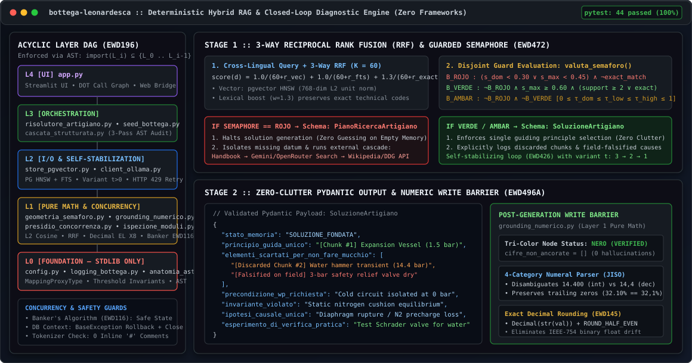

# Bottega Leonardesca & THE Engine

[-brightgreen?style=flat-square&logo=pytest)](tests/test_bottega.py)
[-blue?style=flat-square)](config.py)
[](requirements.txt)
[](https://www.python.org/)
[](LICENSE)

**Deterministic Hybrid RAG (HNSW + Full-Text RRF), Static AST Inspection & Closed-Loop Multilingual Diagnostic Solver for Local LLMs and Free Cloud APIs — Zero Frameworks.**

<p align="center">
  
</p>

Large Language Models fail in production for two structural reasons:
1. **Hallucination on empty memory:** when the context lacks the required datum, a standard LLM guesses by statistical plausibility instead of stopping to request or fetch the missing fact.
2. **Spurious fusion ("clutter effect" / *effetto mucchio*):** when a traditional RAG retrieves multiple heterogeneous chunks, the model blends steps from incompatible procedures and invents numbers absent from the official source.

**Bottega Leonardesca & THE Engine** eliminates both failure modes by replacing opaque frameworks (LangChain / LlamaIndex) with a strictly stratified **13-module Python architecture** across **5 acyclic rings (`Layers 0..4`)**, inspired by Edsger W. Dijkstra's `THE` multiprogramming system (`EWD196`, `EWD310`), Leonardo da Vinci's empirical method, and the production guardrails proven on the **JISO TARIC Assistant** customs system.

---

## Architecture: 5 Acyclic Rings (`EWD196` / `EWD310`)

Every module at layer $L$ may import **exclusively** modules at layer $< L$. Both the acyclic dependency graph and the **complete absence of inline `#` comments** across all 13 application modules are enforced by automated AST and tokenizer tests (`tests/test_bottega.py`).

| Layer | Modules | Engineering Responsibilities & Guards | Dependencies |
| :--- | :--- | :--- | :--- |
| **Layer 0** *(Foundation)* | `config.py`<br>`logging_bottega.py`<br>`anatomia_ast.py` | Threshold invariant validation, immutable `MappingProxyType` hierarchy, multi-provider endpoints (Ollama, Gemini Free, Groq Free, OpenRouter Free), `prod` password guard, UTC ISO-8601 structured logging, pure AST parser. | Standard Library / `.env` only |
| **Layer 1** *(Pure Math & Concurrency)* | `geometria_semaforo.py`<br>`grounding_numerico.py`<br>`ispezione_moduli.py`<br>`presidio_concorrenza.py` | $L_2$ normalization, cosine similarity, pure **Reciprocal Rank Fusion** ($K=60$, weights `1.0 / 1.0 / 1.3`), Guarded Semaphore (`EWD472`), exact `Decimal` rounding (`EWD145`), thousands (`14.400`) vs decimal (`14,4`) separation, **Tri-Color Write Barrier** (`EWD496A`), thread-safe Secretary with $P/V$ Semaphore (`EWD123`), `Holyness Counter` (`EWD113`) and **Banker's Algorithm** (`EWD116`). | **Layer 0** only *(Zero DB, Zero Network)* |
| **Layer 2** *(I/O Connectors)* | `store_pgvector.py`<br>`client_ollama.py` | Transactional PostgreSQL + `pgvector` context manager with `BaseException` rollback, guaranteed `conn.close()` in `finally`, deterministic 768-dim local L2 embedding fallback; HTTP client with cross-lingual query translation (`EN/ES -> IT`), **Self-Stabilization** (`EWD426`), `HTTP 429` exponential backoff and strictly decreasing variant $t > 0$ (`EWD316`). | **Layers 0..1** |
| **Layer 3** *(Domain Orchestration)* | `risolutore_artigiano.py`<br>`cascata_strutturata.py`<br>`seed_bottega.py` | **Closed-Loop Diagnostic Solver** ("Zero Clutter" + cascading external search: *Handbook $\rightarrow$ Gemini/OpenRouter AI Web Search $\rightarrow$ DuckDuckGo/Wikipedia JSON API* on `ROJO` + binary field falsification + Free Web Bridge), **3-Layer Code Review Cascade** (Leonardo $\rightarrow$ antirez $\rightarrow$ Dijkstra). | **Layers 0..2** |
| **Layer 4** *(Presentation)* | `app.py` | Multilingual Streamlit Dashboard (`EN / ES / IT`) with Free Cloud API selector, local PostgreSQL document uploader, Graphviz DOT call graph, and Free Web Bridge for ChatGPT / DeepSeek / Gemini. | **Layers 0..3** |

---

## Quick Start & Verification

### 1. Run the 26 Pure Unit Tests (Zero Network, Zero DB, Zero LLM)
```powershell
python -m venv .venv
.\.venv\Scripts\activate
pip install -r requirements.txt
python -m pytest -v
```

### 2. Full Start via Docker (or double-click `avvia_da_chiavetta.bat` on Windows)
```powershell
copy .env.example .env
docker compose up -d --build
```
The dashboard will be available at `http://localhost:8501`.

### 3. Local Python Execution
```powershell
python seed_bottega.py
python cascata_strutturata.py ispezione_moduli.py
streamlit run app.py
```

---

## License

Released under the **MIT License** (see `LICENSE`).
